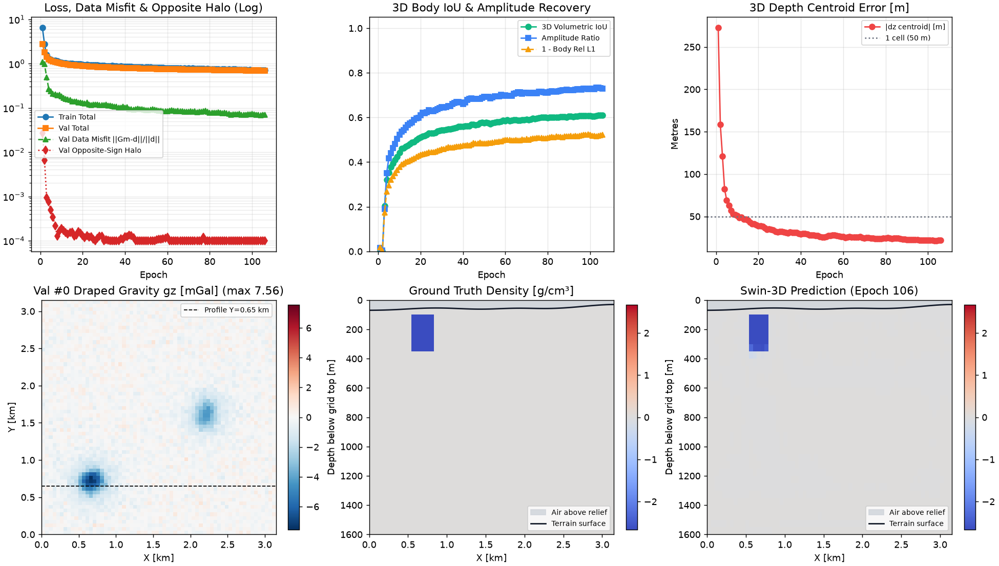
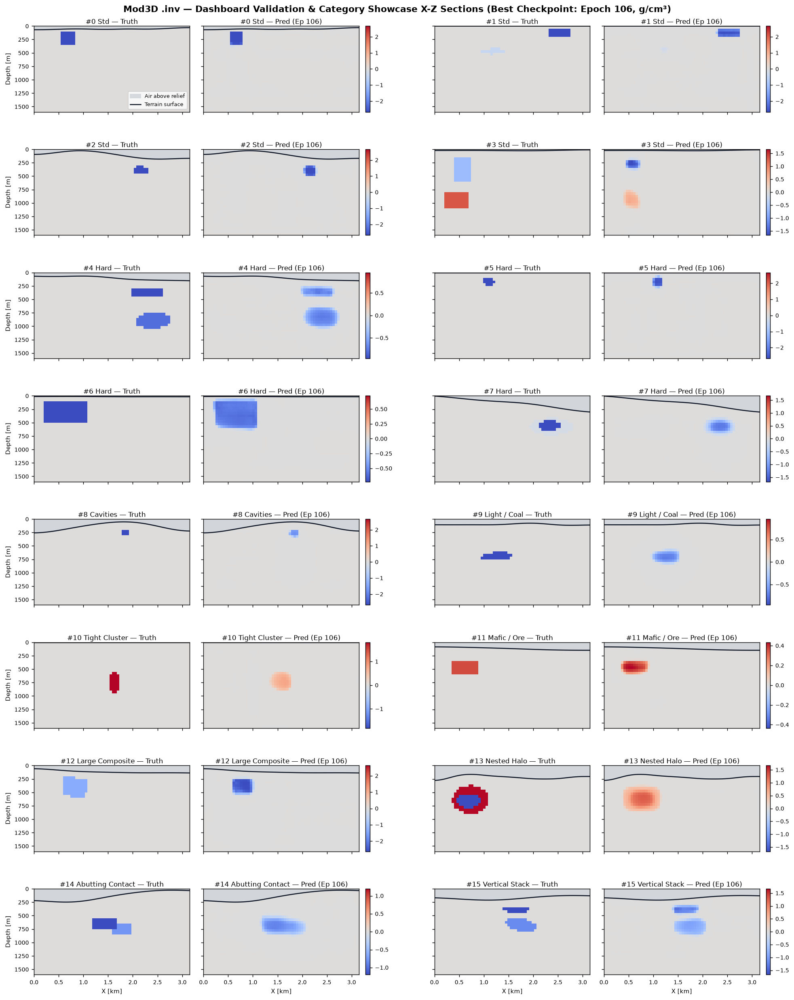

# 3D Potential Field Neural Inversion: Complete Training Guide

> **A Comprehensive Guide to Training Physics-Informed 3D Swin Transformers for Mod3D**  
> *Isolated Bodies & Cavities, Planar Dipping Faults, Multi-Aspect Anisotropy & Station Infill, Green's Vertical Decay Bias, Aleatoric Uncertainty NLL, Differentiable Nagy-Prism Physics, Apple Silicon CoreML/Pure FP32 MPS & Live Training GUI*

---

## 1. Executive Training Strategy

Inverting surface potential field data (gravity $\Delta g$ and magnetics $\Delta T$) into 3D subsurface physical properties ($\Delta \rho, \chi$) is ill-posed and non-unique. Because the Earth has no vast database of true subterranean 3D density volumes with matching surveys, naive deep learning approaches fail:
* Training purely on simple geometric shapes without terrain produces models that fail on real relief (*Out-of-Distribution breakdown*).
* Training purely unsupervised on data misfit $\|G\mathbf{m} - \mathbf{d}\|_2^2$ causes the network to collapse into the non-uniqueness trap, placing all anomalies directly at the ground surface (*Depth attenuation bias*).
* Symmetric L1/L2 penalties produce unphysical opposite-sign "compensating halos" (e.g. negative density halos wrapping a positive orebody to artificially cancel gravity tails) and classic L2 Soft Dice leads to spiky core overshoots on partial volume coverage.
* Global contrast normalization causes weak deep rock bodies to be ignored when high-contrast cavities are present in the same domain.

To solve this, `.inv` employs a **Three-Phase Hybrid Training Strategy**:

```
+---------------------------------------------------------------------------------------------------------+
|                                    3-PHASE HYBRID TRAINING FRAMEWORK                                    |
+---------------------------------------------------------------------------------------------------------+
|                                                                                                         |
|   PHASE 1: SYNTHETIC DATA GENERATION            PHASE 2: PHYSICS-GUIDED TRAINING      PHASE 3: TEST-TIME    |
|   (Stratified Bodies, Cavities & Terrain)       (Differentiable Forward Loop)         ADAPTATION (Mod3D)    |
|                                                                                                         |
|   +--------------------------+                  +---------------------------+         +-------------------+ |
|   | On-The-Fly Geometry      |                  | Draped Nagy Operator G    |         | Real Survey Data  | |
|   | - Waste & ore rock bands |                  | (2-ch batched forward)    |         | from Mod3D JSON   | |
|   | - 50/50 air & water cav. |                  +-------------+-------------+         +---------+---------+ |
|   | - 35/35/30% depth strat. |                                |                                 |           |
|   | - Taper / fold / bend    |                                v                                 v           |
|   | - Planar faults & offsets|                  +---------------------------+         +-------------------+ |
|   | - Ground to drone clear. |                  | Compound Inversion Loss   |         | Pre-trained v5.1  | |
|   | - Missing-station infill |                  | - Fused 3D dilations +gap | ------> | Domain-Scaled     | |
|   +------------+-------------+                  | - Shifted beta-Laplace NLL|         | 5-ch Input        | |
|                |                                | - Stride-2 delta-forward  |         | + Uncertainty Sig | |
|                v                                | - Class-bal CE + bdy Dice |         +---------+---------+ |
|   +--------------------------+                  | - Fixed-denom face jumps  |                   |           |
|   | v5.1 Physics/Geology Swin|                  | - Signed L1-IoU + EDT aux |                   v           |
|   | + Green's Vertical Bias  |                  | - Opposite-halo penalty   |         +-------------------+ |
|   | + Mid-Stage Log-Var Head |                  | - Charbonnier RMSE + grad |         | Uncertainty-      | |
|   | + 18-ch D4 Stem + Occ    |                  +---------------------------+         | Weighted IRLS     | |
|   +--------------------------+                                                        | Refinement        | |
|                                                                                       +-------------------+ |
+---------------------------------------------------------------------------------------------------------+
```

---

### 1.1 `v6.1` Upgrades Summary

Building on `v5.1` and `v6`, **`v6.1`** introduces drop-in architectural, physics, loss, training, and visualization upgrades while keeping the `(1, 5, 64, 64)` static ONNX contract and single-partition CoreML MLProgram compatibility:

* **Forward & Physics Conditioning ([`model_swin3d.py`](file:///Users/igorcerovsky/Documents/Mod3D/.inv/python/model_swin3d.py))**:
  * `OddPyramidGravity` expands `aspect_knots` to 5 knots (`[0.55, 0.75, 1.00, 1.20, 1.40]`) and 32 rational `self_knots` (`u_self_knots`), cutting mid-aspect and self-column forward errors while avoiding redundant adjoint passes via analytical `sensitivity_norm`.
  * Restores `GreensVerticalBias` inside `CoreMLAxialGlobalBlock3D`, adds learnable depth-weighted feedback (`bp_z_beta`, init `0.85`), decouples Stage-1 output heads (`proto_head_init`), adds `cls_depth_prior` lithology depth logits, smooths `occ_4d` occupancy gating, initializes `logvar_out.bias = -4.0`, and auto-migrates `v6.0` checkpoints in `_load_from_state_dict`.
* **Dataset & Survey Parity ([`dataset.py`](file:///Users/igorcerovsky/Documents/Mod3D/.inv/python/dataset.py), [`forward.py`](file:///Users/igorcerovsky/Documents/Mod3D/.inv/python/forward.py))**:
  * Ground-primary survey mix plus elevated relief-draped airborne clearance (`CLEARANCE_CLAMP_V6 = 8.0`), C++ `BackgroundBasis::evaluate()` parity detrending (`cpp_border_eval`, `cpp_border_proj`), disabled Bouguer clutter poisoning (`bouguer_err_prob = 0.0`), bimodal `landfill_plume` thickness, steep dykes, and rebalanced structural archetypes (`listric_graben`, `folded_horizons`, `tight_cluster`, `vertical_stack`, `abutting_contact`).
* **Losses & Smooth Evaluation ([`losses.py`](file:///Users/igorcerovsky/Documents/Mod3D/.inv/python/losses.py), [`evaluate.py`](file:///Users/igorcerovsky/Documents/Mod3D/.inv/python/evaluate.py))**:
  * Removes asymmetric `+0.20 * overshoot` from `l_fg`, sets `lambda_rho_init = 0.10`, tunes Huber-Gaussian NLL (`c_h = 3.0`, stronger `nll_far` calibration), and uses detrend-invariant `_border_project_2d` data misfit.
  * Replaces hard step-cutoff IoU with an anchored smooth support transition (`_smooth_support` in `evaluate.py` and `_unit_and_instance_iou_loss_v6` in `losses.py`) plus far-background coverage (`w_bg_far = d3 + 0.20 * (1 - d3)`), penalizing sub-threshold empty-cell false positives continuously.
  * Adds 4-bucket stratified validation (`make_v6_val_buckets`) and uncertainty calibration metrics (`compute_calibration_metrics`: `unc_spearman`, `aurc`, `bd_sig_err_ratio`, `fg_1sig_cov`).
* **Resume & Scheduler Persistence ([`train.py`](file:///Users/igorcerovsky/Documents/Mod3D/.inv/python/train.py))**:
  * Adds `build_resume_v6_scheduler` with `--warm-restart`, `--total-epochs`, `--reset-best`, and persisted `optimizer_state_dict` / `sched_state_dict` for seamless multi-stage continuation.
* **C++ Inference, Web Demo & Dashboards ([`neural_prior.hpp`](file:///Users/igorcerovsky/Documents/Mod3D/.inv/include/inv/neural_prior.hpp), [`dashboard.py`](file:///Users/igorcerovsky/Documents/Mod3D/.inv/python/dashboard.py), [`export_demo.py`](file:///Users/igorcerovsky/Documents/Mod3D/.inv/python/export_demo.py))**:
  * Supports 2D spatial clearance conditioning (`ceiling 8.0`) in C++ `NeuralPriorInference` and `Inversion3DDialog`.
  * Updates `.inv/demo/` to 64 random validation scenes (8 samples $\times$ 8 categories) using versioned sidecars (`vol3d_v6.1_meta.js`, `vol3d_v6.1_best.js`), and adds independent 3D relief surface coloring toggles (`Topography` / `Field` on Truth; `Predicted` / `Difference` on Predicted).

### 1.2 `v9` & `v9.1` Upgrades Summary

Building on the controlled `v3`–`v8` ablation findings (where `v7`/`v8`'s 3-tier slab hierarchy and stripped CoreML blocks caused shallow depth bias and `centroid_dz` regression), **`v9`** (`PotentialFieldTransformer3DV9`, `2,729,729` params in `base`, `1,355,098` in `slim`) restores depth accuracy while keeping 6-channel survey/detrend conditioning, and **`v9.1`** adds composite-safe body-lithology coherence supervision:

* **Unified Full-Resolution Decoder (`v9` / `v9.1` in [`model_swin3d.py`](file:///Users/igorcerovsky/Documents/Mod3D/.inv/python/model_swin3d.py))**:
  * Replaces `v7`/`v8`'s 3-tier slab hierarchy (`tier_preds` / `tier_blocks`) with a single unified `(32, 64, 64)` Stage-2 decoder.
  * Restores `GroupNorm` in `SepConv25DBlock`, trilinear residual skip in `SepSubpixelUp3D`, full `z_gate + d_bias` in `DepthConditionedSkip`, 2-layer `cls_depth_prior([d_surf, z_full])`, and `logsumexp + proto_bias` prototype scoring.
  * Uses occupancy-gated Stage-1 coarse prediction (`coarse_occ_head * coarse_rho_head`), detrend-mode-aware `w_bp` physics residual feedback, and `F.softplus(bp_z_beta)` vertical sensitivity scaling.
  * Accepts 6-channel `(1, 6, 64, 64)` input (`19`-channel physics/structural stem + `9`-dim `scale_mlp` conditioning) and outputs `(density_volume, log_var_volume)`.
  * Exports cleanly to ONNX (`density_volume`, `log_var_volume`) with verified CPU (`1.77e-6` max rel diff) and CoreML EP (`5.09e-4` max rel diff, 15 partitions) parity.
  * Pruned dead experimental paths (`focus_refine.py`, `model_flow3d.py`, `train_gen_refiner.py`).
* **`v9.1` Composite-Safe Body-Lithology Coherence Loss (`--variant v9.1`, [`losses.py`](file:///Users/igorcerovsky/Documents/Mod3D/.inv/python/losses.py))**:
  * Adds `_lithology_coherence_loss` weighted by `--lambda-coherence` (default `0.12` for `v9.1`, `0.0` for earlier variants):
    $$\mathcal{L}_{\text{coherence}} = 0.45\,\mathcal{L}_{\text{incompat}} + 0.30\,\mathcal{L}_{\text{cls\_smooth}} + 0.25\,\mathcal{L}_{\text{unit\_purity}}$$
    strictly zero at exact ground-truth match — including **composite multi-lithology bodies** (e.g. coal + ore, or ore core in mafic halo).
  * **Geophysical Incompatibility ($\mathcal{L}_{\text{incompat}}$)**: $7 \times 7$ incompatibility matrix penalizes opposite-sign mixing (`{air, water, coal, sediment}` vs `{mafic, ore}` at `1.0`) and extreme air-cavity vs sediment/coal confusion (`0.35`/`0.15`) inside bodies and sign-exclusive $d_3$ halos, while sparing adjacent same-sign bands.
  * **Within-Unit Smoothness ($\mathcal{L}_{\text{cls\_smooth}}$)**: Penalizes class probability jumps strictly across same-unit, same-lithology interior faces (zeroed across composite unit contacts and outer walls).
  * **Unit Purity & Tightened Interior Core ($\mathcal{L}_{\text{unit\_purity}}$)**: Combines per-unit pooled lithology match (`0.45`), excess within-unit variance (`0.20`, allowing true graded spreads), and interior core occupancy/crispness (`0.35`, evaluating $0.50\,p_{\text{empty}} + 0.50\,(1 - \sum_{k \ge 1} p_k^2)$ strictly on the eroded `core_mask` so empty/washed-out cores are penalized without puffing out boundaries).
* **Loss-Component Observability & Dashboard ([`losses.py`](file:///Users/igorcerovsky/Documents/Mod3D/.inv/python/losses.py), [`train.py`](file:///Users/igorcerovsky/Documents/Mod3D/.inv/python/train.py), [`dashboard.py`](file:///Users/igorcerovsky/Documents/Mod3D/.inv/python/dashboard.py))**:
  * Returns exact weighted loss contributions (`wloss_*` summing to `loss_total`) and logs `train_coherence`, `val_coherence`, `train_wloss_*`, and `val_wloss_*` per epoch in `training_history.json`.
  * Plots coherence in `svgMisfit` and `training_monitor.png`, and adds a full-width **Final Loss Components** chart (`svgLossComp`) with **Val/Train** and **Log/Lin** toggles, interactive legend filtering, and per-epoch `%` share.

---

## 2. Prerequisites & Environment Setup

The training pipeline requires **Python 3.10+** and **PyTorch 2.1+**. It natively supports **Apple Silicon Metal (MPS)**, **NVIDIA CUDA**, and CPU.

### 2.1 Installation

```bash
# Navigate to the python training directory
cd .inv/python

# Create and activate a clean virtual environment
python3 -m venv .venv
source .venv/bin/activate

# Install dependencies
pip install --upgrade pip
pip install -r requirements.txt
```

### 2.2 Verify Device Acceleration

Run the following one-liner to verify your acceleration backend:

```bash
python -c "import torch; print('CUDA Available:', torch.cuda.is_available(), '| MPS (Apple Silicon):', torch.backends.mps.is_available())"
```

---

## 3. Step-by-Step Training Pipeline

### Step 1: Isolated Bodies, Cavities & Terrain Data Generation

Rather than hand-labeling or hunting for paired data, `.inv/python/dataset.py` synthesizes thousands of 3D volumes containing isolated geological bodies and subsurface cavities strictly below random terrain relief:

1. **Physical Target Classes & Lithology Bounds**:
   * **Cavities (24% of bodies)**: Shallow, compact voids or elongated tunnels with **exact physical contrasts** — **air cavities** (`RHO_AIR = -2.67 g/cm³`, 50% of cavities) and **water-filled cavities** (`RHO_WATER = -1.67 g/cm³`, 50% of cavities).
   * **Non-Cavity Geological Lithologies (76% of bodies)**: Rotated compact ellipsoids/blocks and flat or dipping tabular seams/beds/sills across 4 distinct continuous contrast bands:
     * **Light Rock / Coal / Loose Clay & Fill** (`[-1.55, -0.85] g/cm³`, 21% of rocks): coal seams (lignite/bituminous/anthracite), peat, soft porous clay, unconsolidated overburden (55% tabular seam geometry).
     * **Sediments / Compacted Clay / Waste Rock** (`[-0.80, -0.10] g/cm³`, 32% of rocks): sandstone, shale, compacted clay, evaporites/halite, mining waste (45% tabular beds).
     * **Mafic / Ultramafic / Disseminated Ore** (`[+0.15, +0.75] g/cm³`, 32% of rocks): basalt, gabbro, peridotite/dunite/pyroxenite, skarn, weak mineralization (30% dipping sills/dikes).
     * **High-Grade Mineral Ore** (`[+0.80, +1.85] g/cm³`, 15% of rocks): massive sulfide, magnetite/hematite, chromite pods & veins.
2. **Depth Stratification, Hard Contact/Composite Scenes & Multi-Body SNR Guard**:
   * **Mixed Regime (`hard_prob = 0.50`, configurable via `--hard-prob`)**: Half of training scenes follow the standard isolated distribution (`40%` single body, `60%` 2–4 bodies with $\ge 2$-cell separation and lateral margin $\ge 3$ cells), and half sample 5 physically well-posed harder geological archetypes while avoiding full-domain DC Bouguer slab ambiguity and sub-noise companions:
     * `large_composite`: multi-lobe non-convex intrusions, bent seams, and L-shapes (`~1–2.4 km` span, bounded away from lateral edges so anomaly flanks remain inside the observation window, including ridge-hosted crops).
     * `nested_halo`: `ore` cores embedded inside `mafic` halos or `air`/`water` cavities carved inside rock hosts with analytical gravity parity (`0.20–5.0×`).
     * `abutting_contact`: zero-gap adjacent lithology boundaries, fault-thrown offset blocks, and steep dyke feeders intersecting shallower sills.
     * `vertical_stack`: shallow overburden/water lenses directly overlying deeper dense targets (`0.25–4.0×` mGal parity).
     * `tight_cluster`: `3–5` closely spaced (`1`-cell minimum clearance) mixed-lithology targets.
   * Non-cavity rock tops follow explicit **35% shallow / 35% mid / 30% deep** depth stratification below topography.
   * Depth-proportional minimum radii ($r_x, r_y \ge 0.20 \cdot \text{gap} \cdot (n_x/64)$, $r_z \ge 0.14 \cdot \text{gap} \cdot (n_z/32)$) and deep rock contrast floor ($|\Delta\rho| \ge 0.32\text{ g/cm}^3$ when $\text{gap} > 0.22\,n_z$).
   * **Multi-Body Analytical SNR Guard**: Estimates peak surface gravity contribution $\propto |\Delta\rho|\cdot V / z_{\text{eff}}^2$; boosts or skips weaker bodies below $0.10\text{–}0.14\times$ the scene peak so shallow air cavities do not drown weaker targets below noise.
   * **Continuous Geological Shape Deformations & Bounding-Box Dilation**: Non-cavity elongate/tabular bodies deterministically apply continuous strike **wedge tapering** (`taper`), harmonic **folding** (`fold_amp`, `fold_freq`), and **arcuate strike bending** (`bend`) inside `_rasterize_primitive` without perturbing RNG streams. Separation masks are updated via `_dilate_into_blocked` strictly inside each body's padded 3D bounding box.
3. **Random Topography Relief**:
   * Multi-scale Gaussian-filtered random terrain depth $t(x, y)$ with optional regional tilt.
   * Relief up to 25% of total domain depth (15% flat terrain cases for baseline stability).
   * Density strictly zeroed above relief surface (air cells carry zero density contrast).
4. **Realistic Gravimeter Sensor Clearance & Multi-Aspect Grids (`v5` / `v5.1`)**:
   * Covers both ground gravimeter tripod heights (`0.30–1.5 m`) and elevated drone/airborne drape flights (`1.5–80.0 m`), log-uniformly sampled via `_sample_clearance(rng, CLEARANCE_MULTI)`.
   * Multi-aspect ratio grids (`ASPECT_MULTI = (0.55, 0.75, 1.0, 1.20, 1.40)`) train the network on anisotropic vertical voxel aspect ratios ($dz / dx$) with per-aspect forward operator dispatch (`BatchAspectOperator`).
5. **Realistic Structural Augmentations (`v5.1`)**:
   * **Planar Dipping Faults** (`apply_planar_fault`, `--fault-prob 0.40`): Cuts 3D rock bodies along random dipping planes $\mathbf{n} \cdot \mathbf{x} > d$ with $1\text{–}4$ voxel vertical throws, strictly clamped below topography.
   * **Survey Missing-Station Dropout & Harmonic Infill** (`--dropout-prob 0.35`): Simulates flight-line dropouts, inaccessible topography gaps, or irregular station grids; harmonically infills missing observations using Neumann boundary relaxation (`infill_missing_obs`) and encodes station validity in input channel 2 (`valid_mask`).
   * **Decoupled Regional Trend & Regolith Overburden**: In standard geophysical processing, regional trends are decoupled and stripped prior to 3D inversion (residual Bouguer anomaly workflow), while test-time adaptation accounts for remaining shifts. In `v5.1`, synthetic regolith overburden and polynomial regional trend injections were completely removed from training data. This prevents near-surface density smearing and eliminates trend-induced depth metric saturation.
6. **Spatially Correlated 3D Petrophysical Clutter & Surface Noise (Denoising Supervision)**:
   * Real host rocks exhibit spatially correlated internal density variations and surficial station errors.
   * During forward simulation (`simulate_batch`), 3D subsurface heterogeneity (`0.72` white + `0.28` $3\times3\times3$ `avg_pool3d` correlated clutter scaled by $\sigma_{\text{body}} = 0.08 |\rho|$ and host-rock clutter below terrain) is combined with 2D station instrument noise (`0.80` white + `0.20` $3\times3$ `avg_pool2d` correlated noise at $\sigma = 0.5\%\text{–}4\% \cdot \max|g_z|$). Clean and cluttered volumes `[rho, rho_vox]` are evaluated in a single multi-channel `op` call.
   * **Crucial distinction**: The supervision target `rho` remains strictly clean in the background. The network is trained as a true **geological denoiser** that rejects correlated 3D subsurface clutter and correlated surface noise while outputting sharp bodies.
7. **Dihedral $D_4$ Horizontal Symmetry Augmentation**:
   * Gravity physics is strictly equivariant to horizontal rotations and reflections.
   * `augment_d4` applies random $90^\circ, 180^\circ, 270^\circ$ rotations and horizontal reflections on the GPU batch during training, providing $8\times$ effective directional coverage with zero forward modeling overhead.

#### On-The-Fly Generation (Zero Disk Footprint, Recommended)
`BodyTerrainDataset` generates fresh random geometry in DataLoader workers (numpy) while `simulate_batch` runs exact draped-station Nagy prism forward modeling batched on GPU/MPS (~2 ms per sample):
```python
from dataset import BodyTerrainDataset, simulate_batch
from forward import TerrainGravityOperator

# Generates infinite stochastic samples on the fly
dataset = BodyTerrainDataset(n_samples=2000, nx=64, ny=64, nz=32, cell=50.0)
op = TerrainGravityOperator(64, 64, 32, 50.0, 50.0, 50.0, h_min=-85.0).to("mps")
```

---

### Step 2: `v5` / `v5.1` Physics- & Geology-Informed Axial+Swin3D Architecture

The default `v5` / `v5.1` model (`PotentialFieldTransformer3DV5` in `.inv/python/model_swin3d.py`, `2,728,457` params (~2.73M), instantiated alongside legacy `v4`, `v3`, `v2`, and `v1` via `create_model(..., variant="v5")`) integrates learnable Green's decay bias, CoreML-native operators, and dual density + aleatoric uncertainty outputs:

1. **5-Channel Model Input**:
   * `[gz (scaled to 50 m equivalent), terrain_depth / depth_max, valid_mask, log(aspect), clearance / dxy_canon]`.
   * Unpacks to an 18-channel physics stem `_stem_features_v5` and 8-element `scale_mlp` conditioning vector (incorporating mean terrain, relief std, log-aspect, and log-clearance).
2. **Physics-Informed Green's Vertical Decay Attention Bias**:
   * Vertical self-attention in `SwinBlock3D` and `AxialGlobalBlock3D` incorporates a learnable Green's function vertical decay bias:
     $$B_z(|\Delta z|) = \text{gain} \cdot \frac{1}{1 + \text{raw\_decay} \cdot (\Delta z / \Delta z_0)^2} + \text{asym} \cdot \tanh(\Delta z)$$
   * Explicitly embeds Newtonian vertical potential fall-off into the multi-head attention weights.
3. **CoreML / Apple Silicon Optimization**:
   * Avoids `ConvTranspose3d` and 5D `LayerNorm` (which cause ONNX Runtime CoreML Execution Provider fallbacks to CPU).
   * Uses trilinear `nn.Upsample` followed by `nn.Conv3d`, `nn.GroupNorm`, and flattened 3D normalization.
   * Includes `nn.Dropout3d` in MLP blocks with an `enable_mc_dropout()` toggle for Monte Carlo epistemic uncertainty sampling at test time.
4. **Dual Output Heads (Density Contrast + Mid-Stage Aleatoric Log-Variance)**:
   * **Density Contrast** $\Delta\hat{\rho}$: `(B, 1, D, H, W)` in physical $\text{g/cm}^3$, clamped strictly within `[RHO_AIR, RHO_ORE_MAX]` and masked above relief.
   * **Aleatoric Log-Variance** $s = \log(\sigma^2)$: `(B, 1, D, H, W)` clamped to `[-8.0, 4.0]`, projected from mid-stage features (`ch_mid=40`) via `logvar_proj` + `logvar_head`, upsampled smoothly via trilinear interpolation, and masked above relief. This eliminates the heavy full-resolution `mid_swin` and `logvar_refine` blocks of early v5 prototypes, reducing compute while stabilizing uncertainty gradients.
5. **Bidirectional Lithology Prototypes + Calibrated Stage-1 Coarse Residual Feedback**:
   * 7 semantic classes (**0: bg**, **1: air `-2.67`**, **2: water `-1.67`**, **3: light/coal `[-1.55, -0.85]`**, **4: sediment/waste `[-0.80, -0.10]`**, **5: mafic `[+0.15, +0.75]`**, **6: ore `[+0.80, +1.85]`**) × `n_sub=3` sub-prototypes with bidirectional cross-attention (`voxels ↔ prototypes`).
   * At Stage-1 (`32×32×16`), `coarse_rho_head` predicts intermediate terrain-masked contrast `coarse_pred` initialized with zero-centered bias (`+0.3669` logit corresponding to background $\Delta\rho=0$). A frozen non-negative $5\times5$ inverse-cube kernel (`coarse_fwd_conv`, calibrated with $1.35\times$ scaling factor) computes coarse forward field $\hat{g}_{\text{mid}}$, and `res_feedback_2d` + `res_depth_gate` (weighted by learnable `res_gate.tanh()`) inject $[g_{\text{mid}}, \hat{g}_{\text{mid}}, g_{\text{mid}} - \hat{g}_{\text{mid}}]$ back into the 3D decoder.
6. **Terrain-Conditioned Zero-Copy Subpixel Decoder (`SepSubpixelUp3D` + `DepthConditionedSkip`)**:
   * Dual-stage upsampling (`16 → 32 → 64`, `ch_mid=40, ch_vox=24`) pairs a smooth trilinear base with learned XY `pixel_shuffle(2)` + Z `2×` detail, applying `1×1` convolutions on zero-copy `(B, C, D*H, W)` views and gating 2D skips by exact terrain-relative depth `(z - terr)` (`DepthConditionedSkip`).
7. **Depth-Conditioned Log-Odds Prior + Sharpened Foreground Occupancy / Conditional Lithology Mixture**:
   * `cls_depth_prior` adds depth-aware log-odds to prototype logits; a sharpened foreground occupancy gate `occ = sigmoid(occ_sharpness * (fg_lse - logits_bg) + occ_bias)` and conditional active class softmax `active_probs = softmax(logits[1:] * cls_sharpness)` blend as `w_active = 0.45 * probs[1:] + 0.55 * (occ * active_probs)`, preventing background softmax dilution while remaining strictly within `[RHO_AIR, RHO_ORE_MAX]` and masked above terrain. A training-only `edt_head` (`aux["edt"]`) is omitted on ONNX export.
8. **High-Throughput Draped-Station Forward Physics (`forward.py`)**:
   * `TerrainGravityOperator` supports multi-channel density inputs `(B, C, nz, nx, ny)` (evaluating `[rho, rho_vox]` in a single call), fuses real and imaginary frequency contractions into a single `torch.bmm`, and supports `level_stride` for fast loss evaluation.

---

### Step 3: Compound Inversion Loss, Lithology Supervision & Boundary Sharpening

The loss formulation in `.inv/python/losses.py` (`CompoundInversionLoss`) addresses the core physical challenges of potential field inversion:

$$\mathcal{L}_{\text{total}} = \mathcal{L}_{\text{sup}} + \lambda_{\text{cls}} \mathcal{L}_{\text{cls}} + \mathcal{L}_{\text{edt}} + \lambda_{\text{coarse}} \mathcal{L}_{\text{coarse}} + \lambda_{\text{nll}} \mathcal{L}_{\text{nll}} + \lambda_{\text{data}} \mathcal{L}_{\text{data}}$$

Every structural term is **scale-normalized per sample** by $a = \max |m_{\text{true}}|$, ensuring that a weak mineral/waste rock body and a $-2.67\text{ g/cm}^3$ air cavity contribute proportionally without collapsing to zero:

$$\mathcal{L}_{\text{sup}} = 0.23\left(\mathcal{L}_{\text{fg}} + \mathcal{L}_{\text{dist-L1}} + \mathcal{L}_{\text{Tanimoto}} + \mathcal{L}_{\text{grad}}\right) + 0.12\,\mathcal{L}_{\text{band}} + \mathcal{L}_{\text{halo}} + \lambda_{\text{ms}}\,\mathcal{L}_{\text{MGS}} + \lambda_{\text{amp}}\,\mathcal{L}_{\text{amp\_cons}}$$

#### 1. Depth-Weighted & Local-Contrast Foreground Error ($\mathcal{L}_{\text{fg}}$)
$$\mathcal{L}_{\text{fg}} = \frac{\sum_{j \in \text{body}} w_z(z_j) \left(e_{\text{loc}, j} + 0.35\,e_{\text{loc}, j}^2 + 0.20\,\text{Overshoot}_j\right)}{\sum_{j \in \text{body}} w_z(z_j)}$$
where:
* **Local Contrast Normalization**: $e_{\text{loc}, j} = \frac{|p_{n,j} - t_{n,j}|}{\max(|t_{n,j}|, 0.05)}$ normalizes error by the body's actual local contrast. In scenes containing both a $-2.67\text{ g/cm}^3$ cavity and a $+0.2\text{ g/cm}^3$ deep rock body, this prevents the cavity from dominating the supervised gradient.
* **Mild Core Overshoot Guard**: $\text{Overshoot}_j = \frac{\text{ReLU}(|p_{n,j}| - |t_{n,j}|)}{\max(|t_{n,j}|, 0.05)}$ guards against spiky cones without systematically pulling interior amplitudes down.
* **Depth Ramp**: $w_z(z) = 1.0 + \text{depth\_boost} \cdot z / z_{\max} \in [1.0, 1.5]$ (default `depth_boost = 0.5`) counteracts the natural $1/z^2$ decay of gravity sensitivity, specifically sharpening deep targets and bottom contacts.

#### 2. Multi-Scale 3D Distance & Inter-Body Gap Saddle Penalty ($\mathcal{L}_{\text{dist-L1}}$)
Using fused multi-channel separable 3D max-pooling dilations (3 chained calls computing $r = 1, 3, 7$ for foreground, sign zones, and contrast bands simultaneously) plus directional same-axis gap detection (`_gap_saddle_mask`, background voxels bracketed on opposite sides within `1–3` cells):
$$w_{\text{dist}} = 1.0 + 1.5\,(1 - m_{\text{fg}}) + 1.5\,(1 - d_1) + 2.0\,(1 - d_3) + 4.0\,(1 - d_7) + 6.0\,m_{\text{gap}}$$
* **Inside true body ($m_{\text{fg}} = 1$)**: $1.0\times$; **Immediate outer shell ($r = 1$)**: $2.5\times$; **Near ($r \in [2, 3]$)**: $4.0\times$; **Far ($r > 7$)**: $10.0\times$; **Inter-body gap saddle ($m_{\text{gap}} = 1$)**: $+6.0\times$ bonus penalty to prevent tightly clustered or stacked bodies from bridging.

#### 3. Opposite-Sign Compensating Halo Penalty ($\mathcal{L}_{\text{halo}}$)
Sign-aware proximity zones identify regions around positive and negative bodies; opposite-sign compensating halos receive a dedicated proximity-weighted penalty with multiplier $\beta_{\text{halo}} = 3.0$.

#### 4. Fixed-Denominator 3D Face-Jump Gradient & Interior Flatness ($\mathcal{L}_{\text{grad}}$)
To avoid denominator blow-up when predictions are flat inside bodies while enforcing razor-sharp step boundaries:
$$\mathcal{L}_{\text{grad}} = 0.40\,\frac{\sum_f |\Delta_f p - \Delta_f t| w_z}{\sum_f |\Delta_f t| w_z + 10^{-4}} + 0.35\,\frac{\sum_{f \in \text{contact}} |\Delta_f p - \Delta_f t| w_z}{\sum_{f \in \text{contact}} w_z} + 0.25\,\frac{\sum_{f \in \text{interior}} |\Delta_f p| w_z}{\sum_{f \in \text{interior}} w_z}$$
Using only the fixed true gradient norm in the denominator preserves steepness right on contact faces while driving interior body gradients to zero.

#### 5. Multi-Band Mass Conservation ($\mathcal{L}_{\text{band}}$) & Zhdanov MGS ($\mathcal{L}_{\text{MGS}}$)
* **$\mathcal{L}_{\text{band}}$**: Enforces regional mass balance separately across strong negative cavities ($t_n \le -0.5$), weak negative waste rock ($-0.5 < t_n < 0$), strong ore ($t_n \ge 0.5$), and weak ore ($0 < t_n < 0.5$) so weaker targets do not disappear beside cavities.
* **$\mathcal{L}_{\text{MGS}}$**: Evaluates `ZhdanovFocusingLoss.minimum_gradient_support` on predicted vs. true normalized models (weighted by `--lambda-ms`, default `0.05`).

#### 6. Class-Balanced Lithology Loss ($\mathcal{L}_{\text{cls}}$) & Surface-Distance ($\mathcal{L}_{\text{edt}}$)
When training `v2`/`v3`/`v4` (`aux["logits"]`, weighted by `--lambda-cls`, default `0.25`), `_lithology_loss` supervises the 7 classes `{bg, air, water, light, sediment, mafic, ore}` with:
* Class-balanced foreground CE (`50%` voxel-averaged + `50%` per-present-class mean so rare `air`/`water` cavities match `sediment`/`mafic` gradient strength), `gap_mask`-weighted boundary CE (`0.35`), and far background CE (`0.15`).
* Soft Dice over present foreground classes **plus boundary-shell background (`class 0` inside $d_3$)** and absent-class leakage suppression.
* **Surface-Distance Head ($\mathcal{L}_{\text{edt}}$, `v3`/`v4`)**: Supervises `aux["edt"]` against iterative 3D morphological interior depth (`_interior_edt_proxy`) with gap-saddle weighting (`+3×`) so body cores peak separately from narrow gaps.

#### 7. Signed L1-IoU / Tanimoto Loss & V6.1 Smooth Support IoU ($\mathcal{L}_{\text{Tanimoto}}, \mathcal{L}_{\text{unit-IoU}}$)
$$\mathcal{L}_{\text{Tanimoto}} = 1.0 - \frac{2 \sum \min\left(\text{ReLU}(p_n \cdot \text{sgn}(t_n)), |t_n|\right)}{\|p_n\|_1 + \|t_n\|_1 + \epsilon}$$
Guarantees the **unique global optimum is strictly $p_n = t_n$** regardless of partial spatial coverage.

In `v6.1` (`_unit_and_instance_iou_loss_v6`), per-instance Tversky ($\alpha = 0.35$, $\beta = 0.65$) and per-unit `unit_id` IoU use a **smooth anchored support transition** centered at $u = 0.5$ ($50\%$ of local reference contrast) instead of a steep step cutoff:
$$w(u) = \text{clamp}\!\left(0.85\,\frac{\sigma(6(u - 0.5)) - \sigma(-3)}{\sigma(3) - \sigma(-3)} + 0.15\,u,\; 0,\; 1\right)$$
* **Zero at exact background ($u = 0$), $0.5$ at $u = 0.5$, $1.0$ at $u \ge 1$**, with a strictly positive slope across $(0, 1)$ so sub-threshold predictions are penalized smoothly without a $0.49 \to 0.51$ cliff.
* **Far-background false-positive coverage**: Empty subsurface cells outside the 3-voxel body dilation $d_3$ remain active with weight $w_{\text{bg,far}} = d_3 + 0.20\,(1 - d_3)$ (using scene mean foreground contrast `bg_ref` as reference), preventing unpenalized background leakage outside $d_3$.

#### 8. Shifted Beta-Laplace Aleatoric NLL ($\mathcal{L}_{\text{nll}}$, `v5`)
When `aux["log_var"]` is present (weighted by `--lambda-nll`, default `0.06`):
$$\mathcal{L}_{\text{nll}} = \sigma^\beta \left(|\hat{\rho} - \rho| \exp(-0.5 s) + 0.5 s + 4.0\right)$$
where $s = \log(\sigma^2) \in [-8.0, 4.0]$ and $\sigma^\beta = \exp(0.5 \beta s)$ (detached, with $\beta = 0.5$).
Zone balancing divides NLL into:
* **Foreground body error** (`50%`)
* **Immediate boundary shell** (`35%` inside dilation $d_3$)
* **Far background** (`15%`)

This prevents empty zero-density regions from dominating uncertainty training while driving $\sigma$ down in solid formations and up on difficult or ambiguous contacts.

#### 9. Stage-1 Coarse Supervision & Amplitude Consistency ($\mathcal{L}_{\text{coarse}}, \mathcal{L}_{\text{amp\_cons}}$)
* **$\mathcal{L}_{\text{coarse}}$** (`lambda_coarse = 0.20`): Supervised coarse loss and signed IoU loss on Stage-1 intermediate prediction `coarse_pred` against $2\times$ average-pooled true density, anchoring the coarse multi-scale hierarchy before refinement. In `v5.1`, smooth L1 loss with $\beta=0.01$ and explicit FP32 casting is used to eliminate gradient saturation and numerical stutter around zero background contrast.
* **$\mathcal{L}_{\text{amp\_cons}}$** (`lambda_amp = 0.08`): Scale-invariant foreground and body-core mean amplitude ratio consistency, ensuring recovered body mass matches analytical expectations regardless of domain volume.

#### 10. Charbonnier RMSE & Horizontal-Gradient Data Misfit ($\mathcal{L}_{\text{data}}$)
$$\mathcal{L}_{\text{data}} = 0.65\,\mathcal{L}_{\text{amp}} + 0.35\,\mathcal{L}_{\nabla d}$$
where $\mathcal{L}_{\text{amp}}$ and $\mathcal{L}_{\nabla d}$ use zero-at-exact Charbonnier relative RMSE ($\sqrt{\|r\|_2^2 / \|d\|_2^2 + 10^{-6}} - 10^{-3}$) over surface $g_z$ and its horizontal $(x, y)$ differences evaluated by linearity on the model residual via `forward_op(m_pred - m_true, z_obs, level_stride=2)`, halving loss FFT slices while keeping exact zero misfit at $m_{\text{pred}} = m_{\text{true}}$.

#### 11. Domain Input Scaling & Linear Amplitude Projection at Inference
* Both `infer_prior.py` (`amplitude_scale`) and C++ `inv::NeuralPriorInference::predict` (`neural_prior.hpp`) rescale input surface `gz` by $50\text{ m} / L_{\text{eff}}$ before ONNX/PyTorch inference so real domains of arbitrary cell size map into calibrated $50\text{ m}$ training gravity units and true $\text{g/cm}^3$ contrast bounds.
* For legacy **v1** models, `infer_prior.py` (`project=None`, auto-enabled for v1) applies 1-step `project_amplitude` scaling; for calibrated **v2/v3/v4/v5/v5.1** models, raw bounded predictions are preserved unless `--project` / `project=True` is explicitly requested.

---

### Step 4: Executing the Training Run & Live Monitoring

Run the training loop using `train.py`:

```bash
# Basic run with automatic device selection (MPS on Mac, CUDA on Linux)
python train.py --epochs 20 --steps 200 --batch-size 8

# Live macOS GUI window with 6 visual panels updated every epoch
python train.py --epochs 20 --steps 200 --batch-size 8 --gui

# Smoke test (~1 minute)
python train.py --epochs 2 --steps 20 --n-val 8

# Extended multi-hour training run (v9.1 with lithology coherence, pure FP32)
python train.py --variant v9.1 --epochs 120 --steps 250 --batch-size 8 --lr 5e-4 --n-val 64 --gui --save-dir ./checkpoints_v9_1

# Warm-start v9.1 from a finished v9 checkpoint on clean V3 ground data
python train.py --variant v9.1 --v3-data --resume checkpoints_v9_v3data/best_swin3d.pt --warm-restart --reset-best --epochs 40 --lr 1.5e-4 --n-val 128 --gui --save-dir ./checkpoints_v9_1_v3data

# Resuming / Fine-tuning with automatic Cosine Annealing decay
python train.py --resume checkpoints_v9_1/best_swin3d.pt --epochs 40 --lr 1.5e-4 --n-val 128 --gui --save-dir ./checkpoints_v9_1
```

#### Training Arguments

| Argument | Default | Description |
| :--- | :--- | :--- |
| `--epochs` | `20` | Number of training epochs. |
| `--steps` | `200` | Optimizer steps per epoch (batches generated on the fly). |
| `--batch-size` | `8` | Mini-batch size (8 fits comfortably in Apple Silicon unified memory). |
| `--lr` | `5e-4` | Learning rate (`OneCycleLR` with `div_factor=10, final_div_factor=50` from scratch; `CosineAnnealingLR` on `--resume` or warmup+cosine for `v6`–`v9.1`). |
| `--lambda-data` | `0.50` (`v6`–`v9.1`) / `0.25` (`v1`–`v5`) | Weight on draped Charbonnier RMSE + gradient data misfit $\mathcal{L}_{\text{data}}$. |
| `--lambda-ms` | `0.05` | Weight on Zhdanov Minimum Gradient Support structural match. |
| `--lambda-cls` | `0.25` | Weight on 7-class lithology prototype cross-entropy + soft Dice ($\mathcal{L}_{\text{cls}}$). |
| `--lambda-coherence` | `0.12` (`v9.1`) / `0.0` (others) | Weight on composite-safe body-lithology coherence loss ($\mathcal{L}_{\text{coherence}}$). |
| `--depth-boost`| `0.5` | Linear vertical sensitivity ramp $w_z(z) = 1.0 + \text{depth\_boost} \cdot z/z_{\max}$. |
| `--ema-decay` | `0.997` (`v6`–`v9.1`) / `0.995` (`v1`–`v5`) | Exponential moving average (`ModelEMA`) decay for validation and `best_swin3d.pt` weights (`0` disables). |
| `--n-val` | `64` | Fixed seeded standard validation samples (`hard_prob=0.0`, `seed=2024`, plus `n_val//2` hard-only samples `seed=3024` when `--hard-prob > 0`). |
| `--hard-prob` | `0.50` | Fraction of training batches using harder composite, nested, abutting, stacked, and tight-cluster scenes `[0.0-1.0]`. |
| `--num-workers` | `4` (`v6`–`v9.1`) / `0` (`v1`–`v5`) | PyTorch DataLoader workers. |
| `--gui` | `False` | Opens a live native GUI window with 6 real-time training graphs. |
| `--save-dir` | `./checkpoints` | Checkpoint directory (`best_swin3d.pt`, `last_swin3d.pt`). |
| `--variant` | `v5` | Architecture variant (`v9.1`, `v9`, `v8`, `v7`, `v6`, `v5`, `v4`, `v3`, `v2`, `v1`). |
| `--model-size` | `base` | Capacity tier (`slim`, `base`, `heavy`) for `v5`–`v9.1`. |
| `--v3-data` | `False` | Train and validate `v6`–`v9.1` on the clean V3 ground dataset (`v6_mode=False`). |
| `--v3-loss` | `False` | Use V3 symmetric Jaccard/supervision/NLL/data loss instead of V6 Tversky losses. |
| `--dropout` | `0.05` | Dropout3d rate for `v5`–`v9.1` Monte Carlo epistemic uncertainty. |
| `--fault-prob` | `0.40` | Probability of planar dipping fault cuts on 3D rock bodies. |
| `--dropout-prob` | `0.35` | Probability of survey missing-station dropout with harmonic infill. |
| `--no-amp` | `False` | Deprecated no-op; all training is executed in pure float32 (FP32). |
| `--resume` | `""` | Checkpoint path to resume or warm-start from (cross-variant migration supported into `v7`–`v9.1`). |
| `--warm-restart` | `False` | Start a fresh cosine warmup+decay LR schedule over `--epochs` when resuming. |
| `--reset-best` | `False` | Re-baseline best validation loss on `--resume`. |
| `--total-epochs` | `0` | Optional cumulative end epoch for continuous cosine decay across resumes. |

#### Precision & Hardware Acceleration (Pure FP32)
* **Pure `float32` Execution**: All training forward/backward loops execute strictly in single precision (`torch.float32`) across Apple Silicon (MPS), NVIDIA GPUs (CUDA), and CPU.
* **Why MPS `bfloat16` was removed**: On Apple Silicon Metal Performance Shaders (MPS), `bfloat16` autocast suffered from numerical subnormal zero-snapping during fine forward residual evaluation, leading to optimization stalls (`IoU ~0.47`, `centroid_dz ~50m`) and up to ~490s/epoch runtimes. In pure FP32, `v5.1` achieves stable non-saturating convergence and runs ~26–32% faster (~330–370s/epoch) on M-series unified memory.
* `--no-amp` is retained purely for backwards CLI compatibility as a deprecated no-op.

#### Live Monitoring & Decoupled Dashboard (`dashboard.py`) & Static Demo (`export_demo.py`)
`train.py` stays strictly focused on the training loop and delegates all visualization, GUI windows, HTML/WebGL2 dashboard generation, and compact sidecars (`vol3d_meta.js`, `vol3d_best.js`) to `dashboard.py`. Even when running headless or via SSH, `TrainingMonitor` continuously updates:
1. **Interactive GUI Window** (`--gui`): Native window with live loss curves, metrics, and geological sections.
2. **HTML5 Direct Canvas + WebGL2 3D Web Dashboard** (`checkpoints/dashboard.html`): Renders raw numerical voxel arrays onto HTML5 `<canvas>` and WebGL2 3D volume raycasting (shared `cam3d = { yaw: -0.62, pitch: -0.22, dist: 4.0 }` below-horizon camera with full exit caps on flat surfaces and terrain isolines visible from both above and below), supporting real-time epoch history and replay.
3. **Standalone Static Demo Export** (`python export_demo.py`): Generates `.inv/demo/` (`index.html`, `preview_2d.js`, `vol3d_meta.js`, `vol3d_best.js`) containing only the best-epoch 2D/3D visualizations in a `2×2` grid starting at scene `#5`, omitting training curves, metrics, and checkpoints.
4. **High-Resolution Snapshot** (`checkpoints/training_monitor.png`): 6-panel summary chart updated every epoch:
   * **Panel 1 (Losses)**: Train Loss, Val Loss, Relative Data Misfit, Opposite-Sign Halo loss.
   * **Panel 2 (3D Recovery)**: Smooth 3D Volumetric IoU (anchored support transition centered at $50\%$ ref), Amplitude Ratio ($\sum p / \sum t$), 1 - Body Rel L1.
   * **Panel 3 (Depth Accuracy)**: 3D Depth Centroid Error [m] with 1-cell reference line.
   * **Panel 4 (Draped Gravity Map)**: Surface $g_z$ anomaly [mGal] with profile slice marker.
   * **Panel 5 (Ground Truth X-Z Section)**: Vertical density cross-section below relief with shaded air cells.
   * **Panel 6 (Swin-3D Prediction X-Z Section)**: Predicted vertical density cross-section below relief.

<p align="center">
  
  <br>
  <em><code>v3</code> training curves (loss, data misfit, opposite-sign halo, 3D IoU, amplitude recovery, depth centroid error) and Val #0 gravity &amp; X-Z density section.</em>
</p>

<p align="center">
  
  <br>
  <em>Best <code>v3</code> checkpoint X-Z density predictions vs. ground truth across all 16 dashboard validation &amp; category showcase scenes (4 Std, 4 Hard, and 8 curated lithology/cluster archetypes).</em>
</p>

#### Validation Metrics Reference

| Metric | Meaning | Ideal Value | Zero Model |
| :--- | :--- | :--- | :--- |
| `l1_rel` | Mean whole-volume L1 error / $\max|m_{\text{true}}|$ | `0.000` | $\approx$ Body volume fraction ($\approx 0.003$) |
| `body_l1_rel` | Mean relative L1 error inside true bodies normalized per voxel by $|t_n|$ | `0.000` | `1.000` |
| `data_rel_misfit` | Gravity misfit $\|G m_{\text{pred}} - d\| / \|d\|$ | `0.000` | `1.000` |
| `iou` | Smooth 3D Volumetric Jaccard IoU with anchored support transition centered at $0.5 \times \text{ref}$ (penalizes sub-threshold empty-cell false positives) | `1.000` | `0.000` |
| `centroid_dz` | Mass-weighted per-body vertical-cylinder depth centroid error $|z_{\text{pred}} - z_{\text{true}}|$ | `0 m` | `NaN` (no body) |
| `amp_ratio` | Mass recovery ratio $\sum_{\text{body}} p \cdot \text{sgn}(t) / \sum |t|$ | `1.000` | `0.000` |
| `halo_opp` | Mass fraction sitting in opposite-sign compensating halos | `0.000` | `0.000` |

#### Standalone Evaluation CLI
To evaluate any trained checkpoint on independent standard or hard-only test sets:
```bash
python evaluate.py --checkpoint checkpoints_v5.1/best_swin3d.pt --samples 64
python evaluate.py --checkpoint checkpoints_v5.1/best_swin3d.pt --samples 64 --hard-prob 1.0
python evaluate.py --checkpoint checkpoints_v5.1/best_swin3d.pt --export-examples ../img/training_examples.png
```

---

### Step 5: Exporting to ONNX for Mod3D Deployment

Once training is complete, convert the PyTorch model checkpoint into a portable ONNX runtime model:

```bash
python export_onnx.py \
  --checkpoint ./checkpoints_v5.1/best_swin3d.pt \
  --output ./models/inv_swin3d.onnx
```

* **Model Input**:
  * **v6–v9.1 (6 channels)**: `(1, 6, 64, 64)` [surface gravity gz scaled by `50 m / L_eff`, normalized terrain depth, valid mask, log(aspect ratio $dz/dx$), normalized sensor clearance `clearance / dxy`, detrend mode].
  * **v5 / v5.1 (5 channels)**: `(1, 5, 64, 64)` [surface gravity gz scaled by `50 m / L_eff`, normalized terrain depth, valid mask, log(aspect ratio $dz/dx$), normalized sensor clearance `clearance / dxy`].
  * **v2–v4 (2 channels)**: `(1, 2, 64, 64)` [surface gravity gz, normalized terrain depth].
* **Model Output**:
  * **v5–v9.1**: Dual outputs:
    1. `density_volume`: `(1, 1, 32, 64, 64)` density contrast ($\text{g/cm}^3$, calibrated in `[-2.67, +1.85]`).
    2. `log_var_volume`: `(1, 1, 32, 64, 64)` aleatoric log-variance $\log(\sigma^2) \in [-8.0, 4.0]$.
  * **v1–v4**: Single output `density_volume` `(1, 1, 32, 64, 64)`.
* **Relief Masking**: Built-in — cells above the terrain relief surface are automatically zeroed.
* **Apple Silicon CoreML & C++ Runtime**:
  * `export_onnx.py` automatically validates parity against ONNX Runtime CPU and Apple CoreML Execution Provider (`MLProgram` format).
  * Mod3D loads the model via `inv::NeuralPriorInference::predict` ([neural_prior.hpp](file:///Users/igorcerovsky/Documents/Mod3D/.inv/include/inv/neural_prior.hpp)), automatically enabling CoreML on macOS (`#ifdef __APPLE__`) with CPU fallback, and extracting the uncertainty buffer $\sigma_\rho = \exp(0.5 \cdot \text{log\_var})$ to modulate focusing regularization in [focusing_solver.hpp](file:///Users/igorcerovsky/Documents/Mod3D/.inv/include/inv/focusing_solver.hpp).

#### Generating Neural Priors for Mod3D Inversion JSON
To inject a neural prior into a Mod3D setup JSON:
```bash
python infer_prior.py \
  --setup setup.json \
  --checkpoint checkpoints_v5.1/best_swin3d.pt \
  --output setup_prior.json
```

---

## 4. Phase 3: Test-Time Adaptation on Real Field Surveys

When applying the model to real field data in Mod3D:

1. **Instant Prior Prediction ($< 50\text{ ms}$)**:
   The pre-trained Transformer takes the survey's residual gravity anomaly and predicts an initial 3D density volume $\mathbf{m}_0$.
2. **Test-Time Optimization (TTO / 10–20 Steps)**:
   Because real surveys have local baseline shifts and regional trends, Mod3D performs a quick gradient descent directly on the project's data (or analytically decouples background planar trends in `InversionEngine`):
   * Uses `pfld::InterfaceMesh` (`PfldInterfaceMeshOperator`) as the primary forward operator for exact terrain-conforming forward evaluations with triangular DEM relief facets and horizontal shared quad interfaces (skipping vertical planar facets for maximum speed).
   * Fast FFT block-Toeplitz operator (`ToeplitzGravityOperator`) is retained solely as an optional accelerator and benchmark baseline for flat grids (`use_fft_solver_benchmark = true`).
   * Drives the data misfit residual below $1\%$.
3. **Drillhole & Well Locking**:
   If wells (`mod3d::Well`) or seismic guidelines (`mod3d::Guideline`) exist in the project, known geological contacts and density logs are clamped as fixed Dirichlet boundaries:
   $$\mathbf{m}(\mathbf{r}_{\text{well}}) \equiv \rho_{\text{measured}}$$
   The inversion seamlessly fits the field around the known control points.

---

## 5. Hardware Recommendations & Training Times

| Platform | VRAM / RAM | Grid Resolution | Epochs | Approx. Training Time |
| :--- | :--- | :--- | :--- | :--- |
| **Apple Silicon (M1/M2/M3 Pro/Max)** | 16–36 GB Unified | $64 \times 64 \times 32$ | 35 | $\approx 1.0\text{–}1.5\text{ hours}$ |
| **NVIDIA RTX 3080 / 4080** | 10–16 GB VRAM | $64 \times 64 \times 32$ | 35 | $\approx 35\text{–}45\text{ minutes}$ |
| **NVIDIA RTX 4090 / A100** | 24–80 GB VRAM | $128 \times 128 \times 64$ | 50 | $\approx 2.5\text{–}4.0\text{ hours}$ |
| **Modern Multi-core CPU** | 32 GB RAM | $32 \times 32 \times 16$ | 20 | $\approx 2.0\text{ hours}$ |

---

## 6. Troubleshooting & Best Practices

1. **Out-of-Memory (OOM) Errors**:
   * Reduce `--batch-size` to `4` or `2`.
   * Lower the base grid resolution in `dataset.py` (e.g. from $128 \times 128 \times 64$ to $64 \times 64 \times 32$).
2. **Predictions Are Too Smooth (Blurred Blobs)**:
   * Increase `--lambda-ms` from `0.05` to `0.10` or `--lambda-cls` from `0.25` to `0.35` to sharpen prototype edges.
   * Verify that `--ema-decay` is active and gradients are not masked by missing `--lambda-data`.
3. **Artifacts Near Domain Boundaries**:
   * Ensure `dataset.py` applies zero-padding or periodic reflection along domain borders.
   * Enable 3-level coarse-to-fine hierarchy in `InversionConfig::coarse_to_fine_levels = 3`.

---

## 7. References & Bibliography

### Focusing Inversion & Regularization Theory
1. **Zhdanov, M. S. (2002)**: *Geophysical Inverse Theory and Regularization Problems*. Methods in Geochemistry and Geophysics, Vol. 36, Elsevier, Amsterdam, 628 pp.
2. **Portniaguine, O. & Zhdanov, M. S. (1999)**: *Focusing geophysical inversion images*. *Geophysics*, 64(3), 874–887. [doi:10.1190/1.1444596](https://doi.org/10.1190/1.1444596).
3. **Portniaguine, O. & Zhdanov, M. S. (2002)**: *3-D magnetic inversion with data compression and image focusing*. *Geophysics*, 67(5), 1532–1541. [doi:10.1190/1.1512749](https://doi.org/10.1190/1.1512749).
4. **Li, Y. & Oldenburg, D. W. (1996)**: *3-D inversion of magnetic data*. *Geophysics*, 61(2), 394–408. [doi:10.1190/1.1443968](https://doi.org/10.1190/1.1443968).
5. **Li, Y. & Oldenburg, D. W. (1998)**: *3-D inversion of gravity data*. *Geophysics*, 63(1), 109–119. [doi:10.1190/1.1444302](https://doi.org/10.1190/1.1444302).

### Vision Transformers & Deep Learning Inversion
6. **Liu, Z., Lin, Y., Cao, Y., Hu, H., Wei, Y., Zhang, Z., Lin, S., & Guo, B. (2021)**: *Swin Transformer: Hierarchical Vision Transformer using Shifted Windows*. In *Proceedings of the IEEE/CVF International Conference on Computer Vision (ICCV)*, pp. 10012–10022.
7. **Yu, P., Zhou, L., Zhou, S., Jiao, J., Huang, G., & Lu, P. (2025)**: *Physics-Constrained Three-Dimensional Swin Transformer for Gravity Data Inversion*. *Remote Sensing*, 17(2), 245. [doi:10.3390/rs17020245](https://doi.org/10.3390/rs17020245).

### AI Weather Modeling & Multi-Scale Earth Representation
8. **Bi, K., Xie, L., Zhang, H., Chen, X., Gu, X., & Tian, Q. (2023)**: *Accurate medium-range global weather forecasting with 3D neural networks (Pangu-Weather)*. *Nature*, 619, 533–538. [doi:10.1038/s41586-023-06185-3](https://doi.org/10.1038/s41586-023-06185-3).
9. **Lam, R., Sanchez-Gonzalez, A., Willson, M., Wirnsberger, P., Fortunato, M., Alet, F., et al. (2023)**: *Learning skillful medium-range global weather forecasting (GraphCast)*. *Science*, 382(6677), 1416–1421. [doi:10.1126/science.adi2336](https://doi.org/10.1126/science.adi2336).
10. **Nguyen, T., Brandstetter, J., Kapoor, A., Gupta, J. K., & Grover, A. (2023)**: *ClimaX: A foundation model for weather and climate*. In *International Conference on Machine Learning (ICML)*, PMLR 202:25909–25938.

### Analytical Potential Field Kernels & Reference Implementations
11. **Nagy, D. (1966)**: *The gravitational attraction of a right rectangular prism*. *Geophysics*, 31(2), 362–371. [doi:10.1190/1.1439779](https://doi.org/10.1190/1.1439779).
12. **Cerovský, I.**: *Inv3D: 3D Potential Field Inversion Research Repository*. [https://github.com/igorcerovsky/Inv3D](https://github.com/igorcerovsky/Inv3D).
