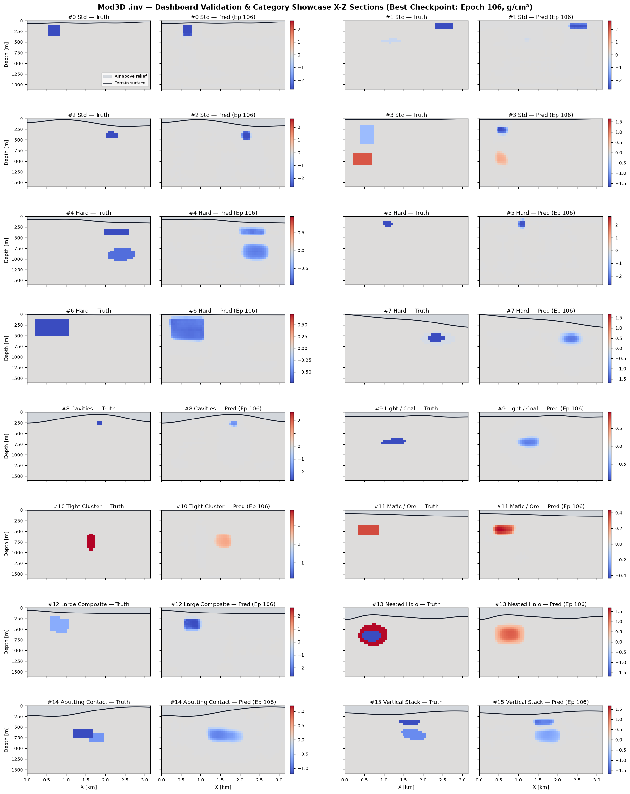
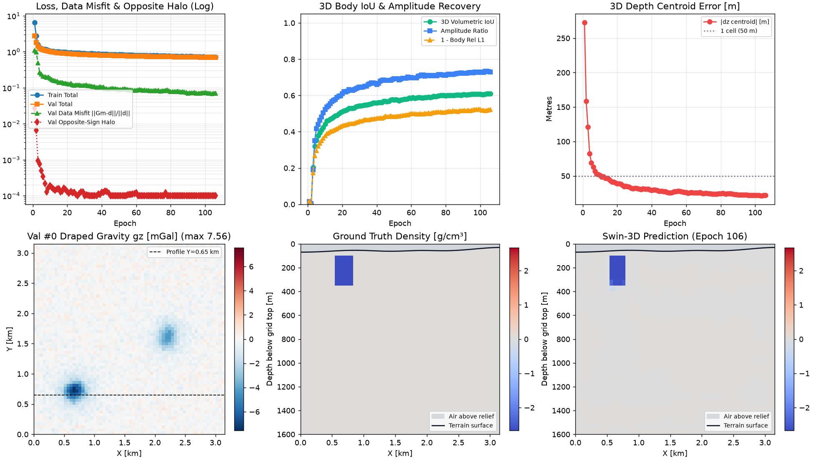

# .inv — 3D Potential Field Neural Inversion Engine

> **Next-Generation 3D Gravity & Magnetic Inversion for Mod3D**  
> *Physics-Guided 3D Swin Transformers & Reweighted Focusing Inversion*

<p align="center">
  <a href="https://igorcerovsky.github.io/Mod3D/">
    
  </a>
  <br>
  <strong><a href="https://igorcerovsky.github.io/Mod3D/">Open Interactive 3D &amp; 2D Web Preview</a></strong> &mdash; WebGL2 volume raycasting, Mod3D Bouguer anomaly terrain draping, and 2D cross-sections across 16 benchmark scenes (<code>v3</code> best model).
</p>

<p align="center">
  
  <br>
  <em>Zero-shot 3D Swin Transformer (<code>v3</code>) gravity inversion directly from surface draped anomalies &amp; terrain relief across 16 synthetic validation and hard composite scenes (cavities, intrusions, clusters, nested halos, abutting contacts, and vertical stacks).</em>
</p>

---

## 1. Overview & Vision

The **`.inv`** sub-project provides an automated, physics-guided 3D potential field inversion framework integrated within **Mod3D**. It bridges classic potential field inverse theory—specifically **Portniaguine & Zhdanov's Reweighted Focusing Inversion**—with state-of-the-art **Transformer architectures** inspired by 3D weather and earth system modeling (**Pangu-Weather**, **GraphCast**, **ClimaX**).

The system divides the subsurface modeling space into 3D voxel cells, predicts physical parameter distributions (density contrast $\Delta \rho$ and magnetic susceptibility $\chi$) directly from surface potential field observations and terrain relief, and refines them using analytical forward operators. Using 7-class learnable lithology prototype embeddings, the v2 neural prior classifies background ($0.0\text{ g/cm}^3$), strict **air cavities** ($-2.67\text{ g/cm}^3$), strict **water-filled cavities** ($-1.67\text{ g/cm}^3$), **light rock / coal / soft clay** ($[-1.55, -0.85]\text{ g/cm}^3$), **sediments / waste** ($[-0.80, -0.10]\text{ g/cm}^3$), **mafic / ultramafic intrusions** ($[+0.15, +0.75]\text{ g/cm}^3$), and **high-grade mineral ore** ($[+0.80, +1.85]\text{ g/cm}^3$) strictly below topography relief.

### Key Architectural Invariant: Complete Core Independence

Like **`pfld`** (Mod3D's standalone facet physics engine), the computational core of `.inv` is:
* **Completely independent** of Qt, OpenGL, or Mod3D GUI libraries.
* Written in standard **ISO C++20**.
* **Header-only / interface-first** for zero-friction integration.
* Fully usable as a standalone library or CLI tool, while being effortlessly embeddable into `mod3d_core` via CMake (`add_subdirectory(.inv)`).
* Accompanied by a dedicated Python sub-project (`.inv/python/`) for synthetic isolated body & cavity training under terrain relief, loss definition, live GUI monitoring, and ONNX export.

```
+-----------------------------------------------------------------------------------------+
|                                    MOD3D ARCHITECTURE                                   |
+-----------------------------------------------------------------------------------------+
|                                                                                         |
|   +-----------------------+     +-----------------------+     +---------------------+   |
|   |         pfld          |     |      mod3d_core       |     |        .inv         |   |
|   | (Facet Physics C++20) | <---+ (Geological Modeling) +---> | (Neural Inv C++20)  |   |
|   |   [Independent Core]  |     |   [Domain Engine]     |     | [Independent Core]  |   |
|   +-----------------------+     +-----------------------+     +---------------------+   |
|               ^                             ^                             ^             |
|               |                             |                             |             |
|               +-----------------------------+-----------------------------+             |
|                                             |                                           |
|                                   +-------------------+                                 |
|                                   |     mod3d_gui     |                                 |
|                                   |  (Qt6 & OpenGL)   |                                 |
|                                   +-------------------+                                 |
|                                                                                         |
|   +---------------------------------------------------------------------------------+   |
|   |                           .inv/python (Training Sub-Project)                    |   |
|   |  - Stratified Bodies, Exact -2.67/-1.67 Cavities  - Multi-Band & Lithology Loss   |   |
|   |  - 35%/35%/30% Depth Stratification & SNR Guard   - Signed L1-IoU & Charb. RMSE   |   |
|   |  - v2 U-Net + 2.5D Swin3D + Proto Embeddings      - EMA, HTML5 Monitor & ONNX     |   |
|   +---------------------------------------------------------------------------------+   |
+-----------------------------------------------------------------------------------------+
```

---

## 2. Why Transformers for 3D Potential Field Inversion?

### The Geophysical Challenge
Potential field inversion (gravity and magnetic) suffers from severe mathematical ill-posedness and non-uniqueness (Green's equivalent layer theorem). Surface observations are 2D, while subsurface sources are 3D. Moreover, potential fields decay with distance:
* Gravity: $\propto 1/r^2$
* Magnetics / Gravity Gradients: $\propto 1/r^3$

Traditional Tikhonov $L_2$ regularization produces diffuse, blurred "blobs" that fail to resolve sharp geological contacts, faults, or compact mineral bodies.

### Why Standard CNNs (3D U-Nets) Fall Short
1. **Limited Receptive Field**: Standard $3 \times 3 \times 3$ convolutional kernels only see local neighbor cells. Potential field physics is inherently **non-local**—a dense body at depth exerts an anomaly across the entire surface survey.
2. **Depth Attenuation Blindness**: Deep stacking and pooling in CNNs smooth out high frequencies, worsening the depth ambiguity.
3. **Rigid Observation Geometry**: Standard CNNs require regular raster grids on flat surfaces, struggling with airborne drape surveys, irregular ground stations, and rugged topography.

### The Transformer Advantage
1. **Global All-to-All Self-Attention**: Self-attention computes dynamic, data-dependent affinity between any two points in the volume:
   $$\text{Attention}(Q, K, V) = \text{Softmax}\left(\frac{Q K^T}{\sqrt{d_k}} + B_{phys}\right) V$$
   where $B_{phys}$ encodes the Green's function distance decay bias directly into the attention matrix.
2. **2D-to-3D Cross-Attention Lifting**: 3D voxel queries $Q(x, y, z)$ attend directly to sparse or irregular 2D surface observation tokens $K(x_{obs}, y_{obs}, z_{obs}), V$, lifting surface measurements into 3D volume space without interpolation distortion.
3. **Multi-Scale Shifted Windows (3D Swin)**: By partitioning the 3D grid into local cubes and shifting windows across layers, 3D Swin Transformers achieve global receptive fields with **linear computational complexity** $\mathcal{O}(N)$, preventing the $\mathcal{O}(N^2)$ memory explosion on large 3D grids ($128 \times 128 \times 64$).

---

## 3. Key Inspirations

### A. Modern AI Weather & Earth System Modeling
State-of-the-art weather forecasting models have revolutionized high-dimensional physical field prediction. We adapt three crucial breakthroughs:
* **Pangu-Weather** (*Bi et al., Nature 2023*): Utilizes a **3D Earth-Specific Swin Transformer (3D-EST)** with anisotropic relative position bias. In geophysics, vertical depth ($z$) behaves fundamentally differently from horizontal strike/dip ($x, y$) due to gravitational decay. We incorporate 3D anisotropic positional bias:
  $$B(\Delta x, \Delta y, \Delta z) = B_{xy}(\Delta x, \Delta y) + B_z(\Delta z)$$
* **GraphCast** (*Lam et al., Science 2023*): Employs a multi-scale encoder-processor-decoder mapping irregular 2D observation networks to multiscale volumetric latent representations.
* **ClimaX** (*Nguyen et al., ICML 2023*): Implements variable-agnostic tokenization. In `.inv`, this allows the model to seamlessly invert any combination of geophysical channels: $\Delta g$ (gravity), $g_{zz}$ (vertical gradient), full tensor gravity gradiometry (FTG), and total magnetic intensity ($\Delta T$).
* **Diffusion Transformers (DiT)**: Enforces generative sampling from the posterior distribution $p(m | d)$, providing geoscientists with multiple physically plausible, sharp geological realizations rather than a single smoothed average.

### B. Reweighted Focusing Inversion (*Portniaguine & Zhdanov, 1999; Zhdanov, 2002*)
Rather than accepting blurred Tikhonov solutions, Zhdanov introduced **focusing stabilizers**:
* **Minimum Support (MS)**: Minimizes the anomalous volume, driving background noise to zero while preserving body cores:
  $$S_{MS}(m) = \int \frac{(m - m_0)^2}{(m - m_0)^2 + e^2} dv$$
* **Minimum Gradient Support (MGS)**: Minimizes the area of non-zero gradients, penalizing diffuse transition zones and producing razor-sharp, blocky geological boundaries:
  $$S_{MGS}(m) = \int \frac{|\nabla m|^2}{|\nabla m|^2 + e_{grad}^2} dv$$

In `.inv`, these stabilizers are embedded directly into the **physics loss function** during training, and utilized in an **unrolled iterative reweighting** architecture that sharpens the predicted voxel volumes.

### C. Evolution from `Inv3D` (*Cerovský*)
Building on Igor Cerovský's original `Inv3D` research (voxelization, kernel precomputation, iterative conjugate gradient solvers, focusing stabilizers), `.inv` upgrades the paradigm:
* From iterative CPU matrix inversions to **instantaneous GPU/NPU neural inference** ($< 50 \text{ ms}$).
* From hand-crafted depth weights to **physics-constrained self-attention**.
* Retention of exact analytical forward verification via `pfld` and Nagy prism kernels.

---

## 4. Sub-Project Directory Layout

```
.inv/
├── CMakeLists.txt              # Independent CMake build definition
├── README.md                   # This project overview & roadmap
├── spec.md                     # Comprehensive technical & mathematical specification
│
├── include/inv/                # Pure C++20 header-only computational core (No GUI/Qt)
│   ├── point.hpp               # 3D vector and coordinate primitives
│   ├── voxel_grid.hpp          # 3D regular voxel domain and tensor buffer
│   ├── forward_kernel.hpp      # Analytical Nagy rectangular prism forward operator & FFT
│   ├── gravity_operator.hpp    # PfldInterfaceMeshOperator (primary), Toeplitz (benchmark), Dense
│   ├── focusing_solver.hpp     # Portniaguine-Zhdanov IRLS solver with Jacobi-PCG & discrepancy cooling
│   ├── focusing_metrics.hpp    # Zhdanov MS and MGS focusing stabilizers & IRLS weights
│   ├── inversion_engine.hpp    # Multi-scale coarse-to-fine focusing engine & Mod3D JSON exchange
│   ├── neural_prior.hpp        # ONNX Runtime 3D neural prior inference & terrain masking
│   └── inv.hpp                 # Umbrella library header
│
├── app/                        # Standalone C++ command-line tool
│   └── inv_app.cpp             # CLI runner for forward modeling, focusing, and inference
│
├── tests/                      # C++ unit tests (GoogleTest)
│   ├── CMakeLists.txt          # Test discovery
│   └── unittest_inv.cpp        # Tests for voxel indexing, Nagy kernel, and Zhdanov metrics
│
└── python/                     # Python training & research sub-project
    ├── requirements.txt        # PyTorch, ONNX, and scientific dependencies
    ├── dataset.py              # Stratified compact/tabular bodies, exact -2.67/-1.67 cavities, [-1.55,+1.85] lithology bands, terrain & noise
    ├── forward.py              # Batched draped Nagy-prism and flat FFT gravity operators
    ├── model_swin3d.py         # v2 U-Net + 2.5D Swin3D + lithology prototype embeddings (with create_model & v1 compat)
    ├── losses.py               # Scale-normalized CompoundInversionLoss, fixed-denom grad, multi-band, lithology CE+Dice, MGS & Charbonnier RMSE
    ├── train.py                # On-the-fly training loop, ModelEMA, OneCycle/Cosine resume, GUI monitor & HTML5 dashboard
    ├── evaluate.py             # Multi-body vertical-cylinder centroid dz, local contrast IoU, amp & halo metrics
    ├── infer_prior.py          # Input-scaled (50 m / L_eff) neural prior writer into Mod3D setup JSON
    ├── export_onnx.py          # PyTorch to ONNX (opset 17) export with terrain relief masking
    └── test_inv_python.py      # Automated 17-test Python & ONNX runtime parity test suite
```

---

## 5. Quickstart & Building

### Standalone C++ Build (Independent Core)

The `.inv` C++ engine can be built completely on its own without Mod3D:

```bash
# Enter the .inv directory
cd .inv

# Configure standalone CMake
cmake -B build -S .

# Build library, CLI app, and unit tests
cmake --build build

# Run unit tests
ctest --test-dir build --output-on-failure

# Run CLI demo
./build/inv_app --help
```

### Integration with Mod3D

To consume `.inv` from the main `Mod3D` repository:
```cmake
# In Mod3D/CMakeLists.txt:
add_subdirectory(.inv)
target_link_libraries(mod3d_core PUBLIC inv)
```

### Python Training Pipeline

> See [**`README-train.md`**](file:///Users/igorcerovsky/Documents/Mod3D/.inv/README-train.md) for the complete, step-by-step training, dataset synthesis, and ONNX deployment guide.

```bash
cd .inv/python
python3 -m venv .venv
source .venv/bin/activate
pip install -r requirements.txt

# Run automated Python test suite (17 tests verifying physics, lithology bounds, losses & ONNX parity)
python test_inv_python.py

# Train 3D Swin Transformer with live macOS GUI window
python train.py --epochs 20 --steps 200 --batch-size 8 --gui

# Smoke test (quick 1-minute verification)
python train.py --epochs 2 --steps 20 --n-val 8

# Evaluate checkpoint on fixed validation set
python evaluate.py --checkpoint ./checkpoints/best_swin3d.pt --samples 64

# Export trained model to ONNX for Mod3D C++ runtime
python export_onnx.py --checkpoint ./checkpoints/best_swin3d.pt --output ./models/inv_swin3d.onnx
```

#### `v3` Training Monitor

<p align="center">
  
  <br>
  <em><code>v3</code> convergence curves and Val #0 gravity map &amp; X-Z density cross-section.</em>
</p>

---

## 6. References & Literature

1. **Zhdanov, M. S. (2002)**: *Geophysical Inverse Theory and Regularization Problems*. Elsevier.
2. **Portniaguine, O. & Zhdanov, M. S. (1999)**: *Focusing geophysical inversion images*. Geophysics, 64(3), 874–887.
3. **Bi, K. et al. (2023)**: *Accurate medium-range global weather forecasting with 3D neural networks (Pangu-Weather)*. Nature, 619, 533–538.
4. **Lam, R. et al. (2023)**: *Learning skillful medium-range global weather forecasting (GraphCast)*. Science, 382, 1416–1421.
5. **Nguyen, T. et al. (2023)**: *ClimaX: A foundation model for weather and climate*. ICML 2023.
6. **Yu, P., Zhou, L., Zhou, S., Jiao, J., Huang, G., & Lu, P. (2025)**: *Physics-Constrained Three-Dimensional Swin Transformer for Gravity Data Inversion*. Remote Sensing, 17(2), 245.
7. **Nagy, D. (1966)**: *The gravitational attraction of a right rectangular prism*. Geophysics, 31(2), 362–371.
8. **Li, Y. & Oldenburg, D. W. (1996)**: *3-D inversion of magnetic data*. Geophysics, 61(2), 394–408.
9. **Cerovský, I.**: *Inv3D: 3D Potential Field Inversion Research Repository*. https://github.com/igorcerovsky/Inv3D.
