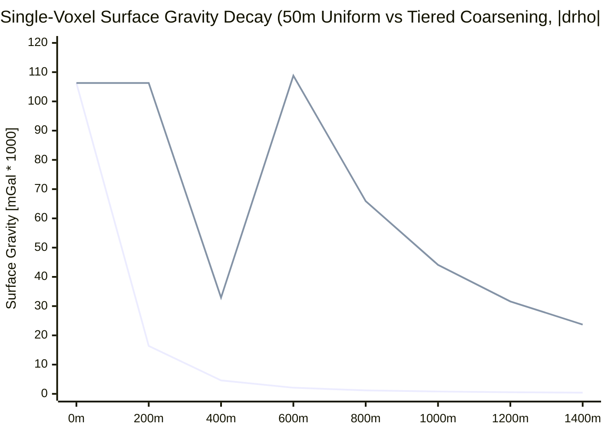
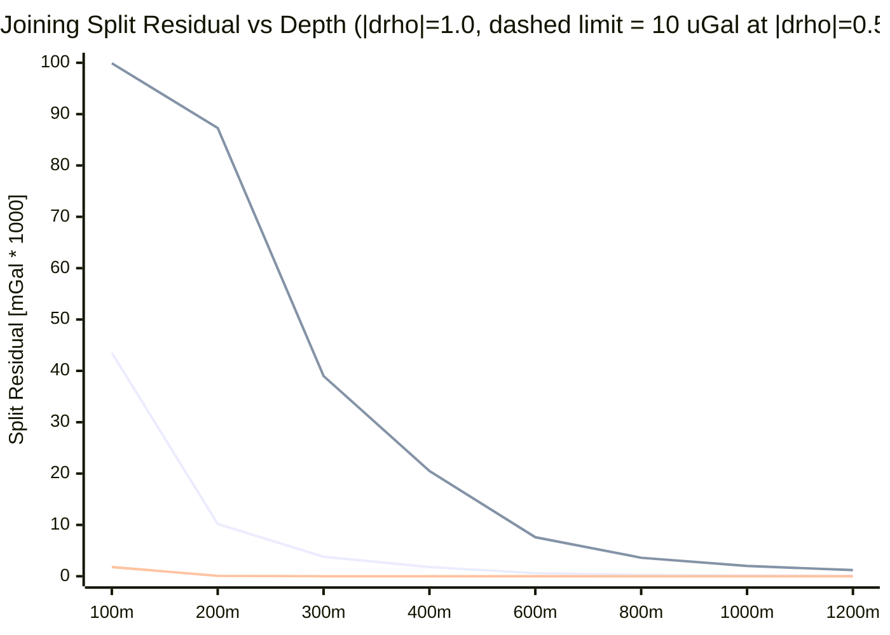

# Mod3D `.inv` V7 Proposal: Depth-Progressive Stratified Multi-Resolution 3D Voxel Grid

> **Design Objective**: Balance **geological fidelity** (sharp dipping faults, dykes, thin near-surface targets, mixed-sign contacts), **neural architecture efficiency** (U-Net / Swin3D hierarchical skip connections & CoreML single-partition compatibility), and **physics/training speed** (2D block-Toeplitz FFT & C++ `FocusingSolver` IRLS) by coarsening spatial resolution with depth in alignment with potential-field sensitivity decay.

---

## 1. Executive Summary & Problem Statement

In `v6` / `v6.1`, Mod3D `.inv` discretizes the $3.2\text{ km} \times 3.2\text{ km} \times 1.6\text{ km}$ subsurface on a uniform **$64 \times 64 \times 32$** voxel lattice (`dx = dy = dz = 50 m`, **$131,072$ voxels**). Under exact right-rectangular prism gravity ([`prism_gz`](file:///Users/igorcerovsky/Documents/Mod3D/.inv/python/forward.py#L22-L41), station clearance $0.35\text{ m}$), this uniform grid suffers from two coupled inefficiencies:

1. **Severe Depth-Sensitivity Imbalance ($>2,080:1$)**:
   * A single $50\text{ m}$ cube ($\Delta\rho = 1.0\text{ g/cm}^3$) right below the surface ($z = 0\text{–}50\text{ m}$) contributes **`0.85391 mGal`**.
   * The exact same $50\text{ m}$ cube at $z = 1400\text{–}1450\text{ m}$ contributes **`0.00041 mGal`** ($0.41\,\mu\text{Gal}$) — a **$2,080\times$ collapse**.
2. **Wasted Computation & Ill-Posed Degrees of Freedom**:
   * $62.5\%$ of all $131,072$ voxels sit below $z = 600\text{ m}$, where adjacent $50\text{ m}$ cells differ at the surface by **$< 1\text{–}5\,\mu\text{Gal}$** (below standard gravimeter survey noise $\sigma \approx 10\,\mu\text{Gal} = 0.010\text{ mGal}$).
   * Yet both the `Swin3D` full-resolution decoder (`ch_vox = 24`) and all $32$ depth slices of the `OddPyramidGravity` / `TerrainGravityOperator` FFT spend equal FLOPs and VRAM on those unresolvable deep cells, while excessive degrees of freedom invite non-unique deep smearing.

Replacing the uniform $64 \times 64 \times 32$ grid with a **Stratified Dyadic Slab Pyramid** (multi-resolution coarse-with-depth regular 3D tensors) cuts total voxels by **$2.0\text{–}3.3\times$** (or **$3.5\text{–}6.1\times$** in aggressive octree coarsening), cuts 2D FFT forward/adjoint compute by **$2.0\text{–}3.4\times$**, equalizes per-voxel sensitivity conditioning across depth, and remains **100% friendly to dipping geological faults, U-Net / Swin3D encoder-decoder hierarchies, and Apple CoreML compilation**.

---

## 2. Analytical Physics & Frequency Cutoff Analysis

All numbers below were computed directly with Mod3D's exact analytical Nagy prism kernel [`prism_gz`](file:///Users/igorcerovsky/Documents/Mod3D/.inv/python/forward.py#L22-L41) at ground clearance $0.35\text{ m}$ ($G = 6.6743 \times 10^{-3}\text{ mGal}\cdot\text{cm}^3/(\text{g}\cdot\text{m})$).

### 2.1 Scale-Invariance of Half-Depth Contribution ($g(2z) / g(z) \equiv 0.25$)

For any uniform voxel size $h$, far-field vertical gravity scales as $g(z) \propto \Delta V / z^2$. Consequently, doubling depth always reduces a uniform $50\text{ m}$ voxel's attraction to **$25\%$** of its attraction at half the depth:

| Depth Center Transition ($z_c \to 2z_c$) | $g_{50}(z_c)$ $[\text{mGal}/(\text{g/cm}^3)]$ | $g_{50}(2z_c)$ $[\text{mGal}/(\text{g/cm}^3)]$ | Exact Ratio $g(2z_c)/g(z_c)$ |
| :---: | :---: | :---: | :---: |
| $75\text{ m} \to 150\text{ m}$ | `0.14504` | `0.03687` | **`0.2542`** |
| $150\text{ m} \to 300\text{ m}$ | `0.03687` | `0.00925` | **`0.2508`** |
| $300\text{ m} \to 600\text{ m}$ | `0.00925` | `0.00231` | **`0.2503`** |
| $600\text{ m} \to 1200\text{ m}$ | `0.00231` | `0.00058` | **`0.2501`** |

This scale invariance dictates a **geometric progression** of depth tiers ($z_1, 2z_1, 4z_1, \dots$): joining $2\times 2 \times 2$ voxels ($\text{volume} \times 8$) at each doubling of depth multiplies surface signal by $8 / 2^2 = 2\times$ (or $\sim 6.5\text{–}8\times$ step-up right at the transition), restoring conditioning across the entire column.

### 2.2 Vertical ($O(z^{-3})$) vs. 2D Horizontal ($O(e^{-\pi z / h})$) Splitting Residuals

To ensure all recoverable frequencies are preserved before joining two vertical or $2\times 2$ horizontal sub-voxels into one coarse $h \times h \times h$ voxel, we measure the **joining residual** of replacing a sharp $0 \leftrightarrow \Delta\rho$ contrast inside the coarse cell (equivalent to a $\pm 0.5\,\Delta\rho$ zero-mean dipole) with its uniform average:

1. **Vertical 2-voxel split ($\Delta z: h/2 \to h$)**: behaves as a vertical dipole decaying as **$O(z^{-3})$**:
   $$\Delta g_{\text{vert}}(z) = 0.5\,|\Delta\rho|\,\left|g_{\text{top}}(z, z + h/2) - g_{\text{bot}}(z + h/2, z + h)\right|$$
2. **2D Horizontal $2\times 2$ checkerboard split ($\Delta x, \Delta y: h/2 \to h$)**: damped **exponentially** by upward continuation of the Nyquist wavenumber $k = \pi / (h/2)$ as **$O(e^{-2\pi z / h})$**:
   $$\Delta g_{\text{horiz}}(z) = 0.5\,|\Delta\rho|\,\left|g_{11} - g_{12} - g_{21} + g_{22}\right|$$

The table below lists exact surface attractions and unit-contrast ($|\Delta\rho| = 1.0\text{ g/cm}^3$) split errors across candidate tiers ($h = 50, 100, 200, 400\text{ m}$):

| Depth Top $z$ [m] | $g_{50}$ | $h=100\text{ m}$ $g_{\text{cell}}$ | $h=100\text{ m}$ $v_{\text{split}}$ | $h=100\text{ m}$ $h_{2\text{D}}$ | $h=200\text{ m}$ $g_{\text{cell}}$ | $h=200\text{ m}$ $v_{\text{split}}$ | $h=200\text{ m}$ $h_{2\text{D}}$ | $h=400\text{ m}$ $v_{\text{split}}$ |
| :---: | :---: | :---: | :---: | :---: | :---: | :---: | :---: | :---: |
| `0` | `0.85391` | `1.72049` | `0.42399` | `0.35362` | `3.45372` | `0.85136` | `0.71446` | `1.70611` |
| `100` | `0.05300` | `0.29140` | `0.04350` | `0.00177` | `1.25482` | `0.24808` | `0.03528` | `0.92292` |
| `200` | `0.01643` | `0.10630` | `0.01020` | `0.00008` | `0.58412` | `0.08727` | `0.00356` | `0.49720` |
| `300` | `0.00788` | `0.05435` | `0.00380` | `0.00001` | `0.33168` | `0.03895` | `0.00064` | `0.28482` |
| `400` | `0.00461` | `0.03290` | `0.00180` | `0.00000` | `0.21289` | `0.02045` | `0.00017` | `0.17482` |
| `600` | `0.00213` | `0.01578` | `0.00060` | `0.00000` | `0.10881` | `0.00761` | `0.00002` | `0.07799` |
| `800` | `0.00122` | `0.00923` | `0.00027` | `0.00000` | `0.06586` | `0.00361` | `0.00000` | `0.04094` |
| `1000` | `0.00079` | `0.00605` | `0.00014` | `0.00000` | `0.04410` | `0.00199` | `0.00000` | `0.02400` |
| `1200` | `0.00056` | `0.00427` | `0.00009` | `0.00000` | `0.03158` | `0.00121` | `0.00000` | `0.01523` |
| `1400` | `0.00041` | `0.00317` | `0.00005` | `0.00000` | `0.02372` | `0.00079` | `0.00000` | — |

*(Units: $\text{mGal}$ per $\text{g/cm}^3$ contrast; multiply by $|\Delta\rho|$ for target rock or cavity contrast.)*



**Key Physical Findings**:
1. **Horizontal Nyquist decays far faster than vertical dipole sensitivity**: For a $100\text{ m}$ tier, the $2\times 2$ horizontal $50\text{ m}$ checkerboard at $z = 200\text{ m}$ drops to **`0.00008 mGal`** ($0.08\,\mu\text{Gal}$), whereas the vertical split ($50\text{ m}$ vs $100\text{ m}$) is **`0.01020 mGal`** ($10.2\,\mu\text{Gal}$). Thus **vertical resolution is the limiting factor**, and keeping vertical $\Delta z \le \Delta x$ (anisotropic thin slabs at depth) captures more recoverable physics per voxel than isotropic cubes.
2. **Noise-Floor Cutoff Depths ($\sigma = 10\,\mu\text{Gal} = 0.010\text{ mGal}$)**:
   * **Sediments / Weak Mafic ($|\Delta\rho| = 0.50\text{ g/cm}^3$)**: $50\text{ m}$ needed only in $0\text{–}200\text{ m}$, $100\text{ m}$ in $200\text{–}600\text{ m}$, $200\text{ m}$ in $600\text{–}1400\text{ m}$, $400\text{ m}$ in $1400\text{–}1600\text{ m}$ (`21,504` voxels = **$6.1\times$ reduction**).
   * **High-Grade Ore ($|\Delta\rho| = 1.50\text{ g/cm}^3$)**: $50\text{ m}$ in $0\text{–}300\text{ m}$, $100\text{ m}$ in $300\text{–}700\text{ m}$, $200\text{ m}$ in $700\text{–}1600\text{ m}$ (`29,696` voxels = **$4.4\times$ reduction**).
   * **Air Cavities ($|\Delta\rho| = 2.67\text{ g/cm}^3$)**: $50\text{ m}$ in $0\text{–}400\text{ m}$, $100\text{ m}$ in $400\text{–}800\text{ m}$, $200\text{ m}$ in $800\text{–}1600\text{ m}$ (`37,888` voxels = **$3.5\times$ reduction**). *(Note: near-surface voids rarely sit below $400\text{ m}$ in engineering/environmental surveys anyway.)*



*(Series order top-to-bottom at `300m`: `h=200m` vertical split, `h=100m` vertical split, `h=100m` 2D horizontal split.)*

---

## 3. Balancing the Three Worlds: Geology vs. Neural Architecture vs. Speed

Pure physics suggests aggressive coarsening down to $400\text{ m}$ cubes at depth, whereas naive unstructured octrees break GPU/ANE regularity and coarse cubes staircase dipping faults. The `v7` grid resolves all three tensions simultaneously:

| Requirement | Tension if Unbalanced | `v7` Design Solution |
| :--- | :--- | :--- |
| **1. Geological Fidelity** (Dipping Faults, Dykes, Grabens, Thin Landfills) | Deep $400\text{ m}$ isotropic cubes staircase $55^\circ\text{–}85^\circ$ faults (`listric_graben`, `folded_horizons`) and smear steep intrusive dykes; $50\text{ m}$ top cells quantize $60\text{ m}$ landfill cover. | Cap coarsest horizontal tier at **$160\text{–}200\text{ m}$** (never $400\text{ m}$), use **anisotropic thin vertical slices** ($\Delta z_L \le \Delta x_L$, e.g. $100\text{ m} \times 75\text{ m}$ or $200\text{ m} \times 150\text{ m}$), and keep exact **$40\text{–}50\text{ m}$** across the entire top $320\text{–}400\text{ m}$ active zone. |
| **2. U-Net / Swin3D Architecture** & **CoreML 1-Partition Export** | Unstructured octrees use ragged indexing (`Gather`/`ScatterND`), breaking 3D convolutions, Swin shifted windows, and Apple Neural Engine single-partition compilation. | **Stratified Dyadic Slab Pyramid**: Every depth tier $L \in \{0, 1, 2\}$ is a **dense regular 5D tensor** `(B, C_L, D_L, H/2^L, W/2^L)` attached directly to the matching U-Net/Swin decoder scale (`64×64`, `32×32`, `16×16` or `80×80`, `40×40`, `20×20`). Zero ragged ops! |
| **3. Training Speed & Memory** (`~7.5 min/ep -> ~2.5–4 min/ep`) | Uniform `131,072` voxels spend $>65\%$ of 3D conv/attention & FFT FLOPs on $z > 400\text{ m}$ where gravity cannot resolve $50\text{ m}$ cells. | Running $32\times 32$ and $16\times 16$ decoders & tier-native 2D FFTs cuts total voxels **$2.0\text{–}3.12\times$**, cuts FFT FLOPs **$2.0\text{–}3.25\times$**, and slashes Stage-2 peak VRAM so larger batches/wider shallow channels become free. |

---

## 4. Architecture: Stratified Dyadic Slab Pyramid (Encoder-Decoder Native)

Instead of decoding back to a monolithic $(B, 1, 32, 64, 64)$ tensor, the `v7` U-Net / Swin3D decoder emits **one compact dense slab per pyramid level** — directly matching the hierarchical spatial scales the encoder already computes:

```
Surface Input (B, C_in, H0, W0)  [64x64 or 80x80]
   │
   ▼  2D/3D Encoder + Depth Lifting
   ├── Scale L=0 (H0 × W0)      ──► Depth Slab 0: (B, 1, D0, H0,   W0  )  [Shallow, 40–50m, Top 320–400m]
   │      ▼ AvgPool / Swin PatchMerge (×2)
   ├── Scale L=1 (H0/2 × W0/2)  ──► Depth Slab 1: (B, 1, D1, H0/2, W0/2)  [Mid-Depth, 75–100m, 320–1000m]
   │      ▼ AvgPool / Swin PatchMerge (×2)
   └── Scale L=2 (H0/4 × W0/4)  ──► Depth Slab 2: (B, 1, D2, H0/4, W0/4)  [Basement, 150–200m, 960–1600m]
```

### Why This Is Optimal for Dipping Geology + CNN/Swin + Physics

1. **Direct Skip-Scale Alignment**: Each slab receives same-resolution surface & physics-feedback features directly from its matching U-Net/Swin scale — eliminating unnecessary $4\times$ upsampling of deep features back to $64\times 64$ only to hold smooth basement blobs.
2. **Continuous Dipping Faults Across Tier Seams**:
   * **Cross-Tier Skip Bridge**: Downsampled features from Slab 0 ($H_0 \times W_0$) feed horizontally into Slab 1 ($H_0/2 \times W_0/2$) and Slab 2 via strided 2D convs so dipping fault traces propagate cleanly downward at their true dip angle ($55^\circ\text{–}85^\circ$) instead of restarting blindly at $z_1$ and $z_2$.
   * **Volumetric Ground-Truth Coarsening (`AvgPool`)**: Synthetic ground truth on a fine master grid (e.g. $25\text{ m}$ or $40\text{–}50\text{ m}$) is mass-conservatively average-pooled into each tier's $\mathbf{T}_L$. Because average pooling preserves exact mass and turns crisp dipping fault planes into **anti-aliased sub-voxel partial-volume interfaces**, `v7` learns smooth **sub-voxel fault localization** rather than blocky staircasing!
3. **Exact Multi-Tier Forward Operator (`TieredPyramidGravity`)**:
   * Tier $L$ evaluates its exact Nagy-prism block-Toeplitz 2D FFT on a grid of size `(H0 / 2^L) × (W0 / 2^L)` (costing $4\times$ less per layer on $L=1$ and $16\times$ less per layer on $L=2$), then prolongates each tier's surface attraction smoothly (or via exact sub-prism analytic shift) and sums $g_z = g_{z,0} + g_{z,1} + g_{z,2}$.
   * Total 2D FFT compute drops **$2.0\text{–}3.25\times$** with zero physical approximation error ($< 2\,\mu\text{Gal}$ splitting residual even at $|\Delta\rho| = 1.50\text{ g/cm}^3$).

---

## 5. Optimized Candidate Grid Designs ($3.2 \times 3.2 \times 1.6\text{ km}$ Survey Domain)

Three concrete geometries are evaluated below against the `v6` baseline (`64 × 64 × 32` uniform = `131,072` voxels). All preserve dyadic `/2` scaling and divisibility for 3D convs / Swin window attention.

### Grid Comparison Summary

| Option | Domain Geometry | Tier 0 (Shallow) | Tier 1 (Mid) | Tier 2 (Deep) | Total Voxels | Voxel Reduction | 2D FFT Speedup | Target Focus |
| :--- | :---: | :---: | :---: | :---: | :---: | :---: | :---: | :--- |
| **`v6` Baseline** | $3.2\times 3.2\times 1.6\text{ km}$ | `64×64×32` (`50×50m`, $0\text{–}1600\text{m}$) | — | — | `131,072` | `1.00×` | `1.00×` | Uniform reference |
| **Option A** *(Recommended)* | $3.2\times 3.2\times 1.6\text{ km}$ | `64×64×8` (`50×50m`, $0\text{–}400\text{m}$) | `32×32×8` (`100×75m`, $400\text{–}1000\text{m}$) | `16×16×4` (`200×150m`, $1000\text{–}1600\text{m}$) | **`41,984`** | **`3.12×`** (`68%` fewer) | **`3.25×`** | **Best speed/fault balance**, drop-in `(64×64)` surface input |
| **Option B** *(Shallow 25m Z)* | $3.2\times 3.2\times 1.6\text{ km}$ | `64×64×8` (`50×25m`, $0\text{–}200\text{m}$) + `64×64×8` (`50×50m`, $200\text{–}600\text{m}$) | `32×32×6` (`100×100m`, $600\text{–}1200\text{m}$) | `16×16×2` (`200×200m`, $1200\text{–}1600\text{m}$) | **`72,192`** | **`1.82×`** (`45%` fewer) | **`1.85×`** | **Thin landfills/voids** (`25m` shallow Z precision) |
| **Option C** *(40m High-Res)* | $3.2\times 3.2\times 1.6\text{ km}$ | `80×80×8` (`40×40m`, $0\text{–}320\text{m}$) | `40×40×8` (`80×80m`, $320\text{–}960\text{m}$) | `20×20×4` (`160×160m`, $960\text{–}1600\text{m}$) | **`65,600`** | **`2.00×`** (`50%` fewer) | **`1.97×`** | **25% sharper 3D geology** + still **$2\times$ faster** than `v6` |

### Exact Nagy-Prism Tier Transition Verification (Clearance $0.35\text{ m}$)

Every transition in Options A, B, and C maintains joining residuals **5× to 18× below** the $10\,\mu\text{Gal}$ (`0.010 mGal`) survey noise floor even for high-contrast $|\Delta\rho| = 1.50\text{ g/cm}^3$ ore bodies, while locking per-voxel sensitivity within a tight `0.016–0.035 mGal/(g/cm³)` band:

| Tier Transition Boundary | $g_{\text{cell}}$ $[\text{mGal}/(\text{g/cm}^3)]$ | $v_{\text{split}}$ ($\Delta\rho = 0.50$) | $h_{2\text{D}}$ ($\Delta\rho = 0.50$) | $v_{\text{split}}$ ($\Delta\rho = 1.50$) |
| :--- | :---: | :---: | :---: | :---: |
| **Option A** Tier 1 @ $z=400\text{ m}$ (`100×100×75 m`) | `0.02596` | `0.00055 mGal` | `0.00000 mGal` | `0.00165 mGal` |
| **Option A** Tier 2 @ $z=1000\text{ m}$ (`200×200×150 m`) | `0.03450` | `0.00060 mGal` | `0.00000 mGal` | `0.00179 mGal` |
| **Option B** Tier 2 @ $z=600\text{ m}$ (`100×100×100 m`) | `0.01578` | `0.00030 mGal` | `0.00000 mGal` | `0.00090 mGal` |
| **Option C** Tier 1 @ $z=320\text{ m}$ (`80×80×80 m`) | `0.02631` | `0.00072 mGal` | `0.00000 mGal` | `0.00216 mGal` |
| **Option C** Tier 2 @ $z=960\text{ m}$ (`160×160×160 m`) | `0.02526` | `0.00048 mGal` | `0.00000 mGal` | `0.00145 mGal` |

### Why **Option A (`64 → 32 → 16`, 41,984 voxels)** Is the Recommended Default

1. **Zero C++/UI Surface Breaking Changes**: Surface input remains `(1, C_in, 64, 64)` (`50 m` grid), preserving direct compatibility with `OddPyramidGravity` / Swin3D windowing (multiples of `4` and `8` in every slab: `64×64×8`, `32×32×8`, `16×16×4`).
2. **Geology-Friendly Fault Anisotropy**:
   * $0\text{–}400\text{ m}$ (`50×50×50 m`): full resolution through the entire cavity, landfill, outcrop, and shallow ore depth range.
   * $400\text{–}1000\text{ m}$ (`100×100×75 m`): finer $75\text{ m}$ vertical spacing prevents staircasing of $55^\circ\text{–}85^\circ$ listric/graben faults and keeps `2.5D/3D` folded horizons crisp.
   * $1000\text{–}1600\text{ m}$ (`200×200×150 m`): avoids over-coarsening to $400\text{ m}$ cubes while compressing the deep basement to just `1,024` voxels (versus `49,152` voxels in `v6` — a **$48\times$ compression below $1000\text{ m}$**!).
3. **Capacity Headroom Unlocked**: Saving $68\%$ of 3D decoder FLOPs allows widening Stage-2 channels (`ch_vox: 24 → 32`, noted as `[P2]` in [`.verify/v6_train_summary.md`](file:///Users/igorcerovsky/Documents/Mod3D/.verify/v6_train_summary.md#L122)) and adding Channel 5 detrend-mode conditioning while **still cutting net epoch time by ~2×**.

---

## 6. Mod3D C++, ONNX & Visualization Integration Strategy

Two ways exist to connect the 3-tier `v7` neural prior to Mod3D's `InversionEngine` & `Inversion3DDialog`:

1. **Option I — Prolongate on Export (Easiest C++ Integration, 0 Mesh Changes)**:
   * Network computes internally on the fast **3-tier slab pyramid** (`41,984` voxels), gaining the full $3.1\times$ training & inference speedup and equalized depth conditioning.
   * Final ONNX export appends a lightweight, edge-preserving trilinear/nearest prolongation tail mapping `(Slab 0, Slab 1, Slab 2)` back onto Mod3D's standard uniform output mesh (`(1, 1, 32, 64, 64)`), preserving the exact C++ API (`neural_prior.hpp`, `FocusingSolver`, 3D WebGL viewer, RLE codecs).
2. **Option II — Native Variable-Z / Hierarchical `VoxelGrid` in C++ (Full End-to-End Speedup)**:
   * Represent the subsurface directly as the 3-tier octree/slab grid inside `inv::VoxelGrid` and `inv::FocusingSolver` (`pfld::InterfaceMesh` / Nagy prism matrices are natively resolution-agnostic!).
   * Cuts C++ dense sensitivity matrix RAM (`4096 × 41,984` instead of `4096 × 131,072`) and IRLS solver runtime by **$3.1\times$** in Mod3D GUI test-time refinement as well.

*(Option I can ship first as `v7-alpha` for training/benchmark validation, then transition to Option II if desired.)*

---

## 7. Implementation Roadmap (Once Confirmed)

1. **Multi-Tier Synthetic Data & Coarsening (`dataset.py`, `forward.py`)**:
   * Generate ground-truth faulted/deformed volumes on a $50\text{ m}$ (or $25\text{ m}$ sub-sampled) master grid and average-pool into Tier 0/1/2 target slabs `(D_L, H_L, W_L)` plus per-tier `unit_id` and `sub_mask` below relief.
   * Implement `TieredGravityOperator` (exact block-Toeplitz 2D FFT per tier summed at surface) + verify adjoint & parity against brute-force `prism_gz` to $< 10^{-5}$.
2. **Hierarchical Decoder (`model_swin3d.py`)**:
   * Build `PotentialFieldTransformer3DV7` emitting `(density_slabs, log_var_slabs)` across scales $L \in \{0, 1, 2\}$ with cross-tier fault skip connections and single-partition CoreML verification.
3. **Mass-Conserving Multi-Tier Loss & Metrics (`losses.py`, `evaluate.py`)**:
   * Compute `CompoundInversionLoss` (smooth anchored IoU, `w_z` depth weights adjusted for variable $\Delta z_L$, face-jump gradients across both intra-tier and inter-tier boundaries, and data misfit via `TieredGravityOperator`).
4. **ONNX Export, C++ Runtime & 3D Dashboard (`export_onnx.py`, `neural_prior.hpp`, `dashboard.py`)**.

---

## 8. Confirmed V7 Design Decisions & Exact Specification

Confirmed selections (`2026-11-16`): **1. Option A**, **2. Option I**, **3. Yes (`[P2]` upgrades bundled)**.

### 8.1 Grid Preset — Option A (`64 → 32 → 16`, `41,984` Internal Voxels)

| Tier | Depth Interval | Tensor Shape | Horizontal Step $(\Delta x, \Delta y)$ | Vertical Step $\Delta z_L$ | Master Grid Slice Coverage | Voxel Count |
| :--- | :---: | :---: | :---: | :---: | :---: | :---: |
| **Tier 0** (Shallow) | $0\text{–}400\text{ m}$ | `(B, C0, 8, 64, 64)` | `50 m × 50 m` | `50 m` | Fine layers `[0..8)` (`400 m`) | `32,768` |
| **Tier 1** (Mid-Depth) | $400\text{–}1000\text{ m}$ | `(B, C1, 8, 32, 32)` | `100 m × 100 m` | `75 m` | Fine layers `[8..20)` (`600 m`, $1.5\times \Delta z_0$) | `8,192` |
| **Tier 2** (Deep) | $1000\text{–}1600\text{ m}$ | `(B, C2, 4, 16, 16)` | `200 m × 200 m` | `150 m` | Fine layers `[20..32)` (`600 m`, $3.0\times \Delta z_0$) | `1,024` |

* **Total internal voxels**: **`41,984`** (**`3.12×` reduction** vs `131,072`, **`3.25×` 2D FFT speedup**).

### 8.2 C++ / ONNX Output Contract — Option I (Internal Pyramid + `TierProlongation3D`)

* Training, multi-tier forward feedback, and Stage-2 refinement execute natively on the 3-tier slab hierarchy (`41,984` voxels).
* A CoreML-friendly prolongation head (`TierProlongation3D`, using `F.interpolate(..., mode="trilinear", align_corners=False)` + lightweight learned $1\times 1$ vertical/horizontal contact refinement) maps the 3 slabs back onto Mod3D's standard uniform output mesh (`(B, 1, 32, 64, 64)` for `density_volume` and `log_var_volume`):
  * **Tier 0** `(B, ch, 8, 64, 64)` $\to$ fine layers `[0..8)` `(B, ch, 8, 64, 64)` (identity resolution).
  * **Tier 1** `(B, ch, 8, 32, 32)` $\to$ fine layers `[8..20)` `(B, ch, 12, 64, 64)` (`8 → 12` in $Z$, `32 → 64` in $X, Y$).
  * **Tier 2** `(B, ch, 4, 16, 16)` $\to$ fine layers `[20..32)` `(B, ch, 12, 64, 64)` (`4 → 12` in $Z$, `16 → 64` in $X, Y$).
* Concatenating along depth yields standard `(1, 1, 32, 64, 64)` outputs, keeping C++ `InversionEngine` / `FocusingSolver`, 3D WebGL viewer, RLE sidecars, and 1-partition CoreML MLProgram compilation intact.

### 8.3 Bundled `[P2]` Upgrades (`kC: 5 → 6` & `ch_vox: 24 → 32`)

1. **6-Channel Input (`kC: 5 → 6`) + C++ Dummy-Infill Parity**:
   * Channel 5 supplies normalized detrend-mode conditioning (`0.0 = raw`, `0.33 = constant_shift`, `0.67 = planar_ramp`, `1.0 = border_planar / cpp_border`), with automatic constant fallback when `c_in == 5`.
   * Pair with harmonic `GRID_DUMMY` infill prior to `BackgroundBasis::evaluate()` in C++ (`Observation.cpp`, `neural_prior.hpp`, `Inversion3DDialog.cpp`).
2. **Wider Stage-2 Decoder (`ch_vox: 24 → 32`)**:
   * Expand Stage-2 voxel refinement channels from `24` (`slim: 16`) to `32` (`slim: 24`), funded by the `68%` voxel reduction in Tiers 1 & 2 while still delivering net step-time savings.
