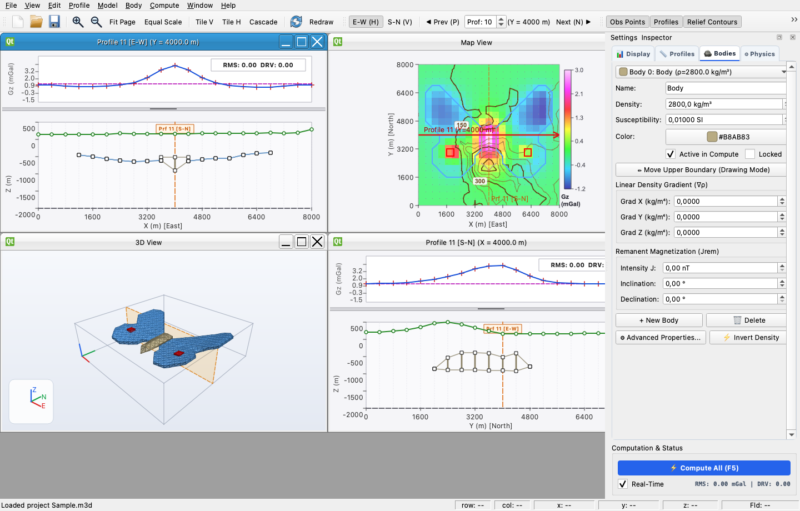
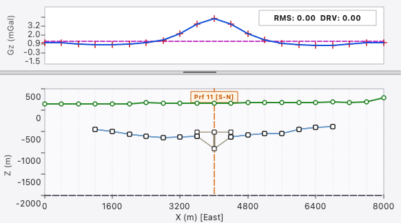
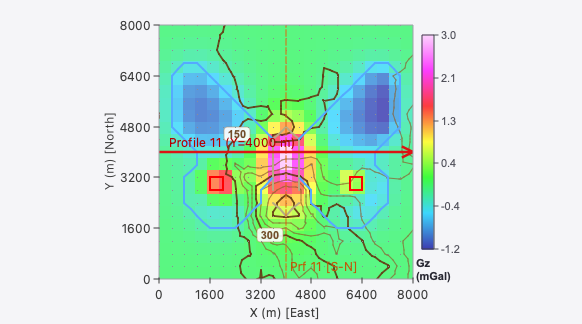
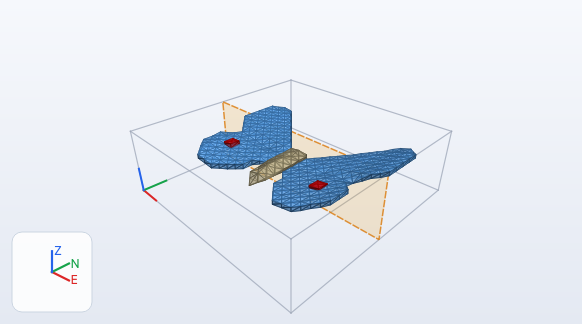
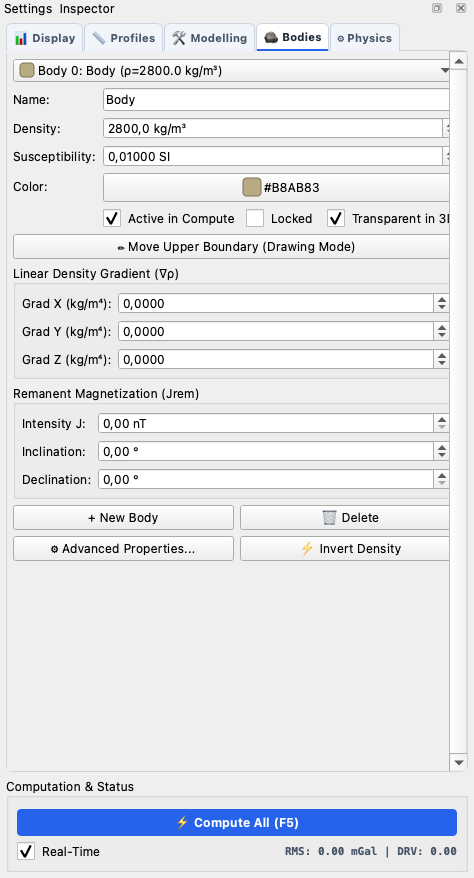

# Mod3D

<div align="center">

[](https://www.gnu.org/licenses/agpl-3.0)
[](https://github.com/igorcerovsky/Mod3D/actions/workflows/build.yml)
[](https://en.cppreference.com/w/cpp/20)
[](https://www.qt.io/)
[](https://cmake.org/)
[]()
[]()

**High-Performance Interactive 2.5D & 3D Forward Modeling and Inversion of Potential Fields**

*Gravity &bull; Gravity Gradient Tensor &bull; Magnetics &bull; Pohánka Analytical Kernels &bull; Real-Time Geological Interpretation*

</div>

---

## Overview

**Mod3D** is a modern, cross-platform geophysical modeling application designed for geologists, geophysicists, and subsurface interpreters. It enables interactive construction, editing, and real-time computation of 2.5D and 3D subsurface geological models with immediate visual feedback against observed gravity, gravity gradient, and magnetic surveys.

Powered by Dr. Vladimír Pohánka's exact analytical polyhedral integration engine, Mod3D eliminates numerical singularities and provides real-time response times ($\le 16\text{ ms}$, 60 FPS) even when editing complex geological structures with multi-directional density gradients.

<p align="center">
  
  <em>Mod3D Multi-View Workspace: East-West and South-North geological cross-sections, 2D potential field map with topography contours, 3D turntable view, and Settings Inspector.</em>
</p>

---

## Key Features

- ⚡ **Real-Time Interactive Modeling**: Instantaneous potential field curve recalculation as vertices or bodies are manipulated via mouse gestures.
- 📐 **Rigorous Analytical Physics Engine**:
  - **Vladimír Pohánka Analytical Method** (1988, 1998): Singularity-free, exact boundary integrals for arbitrary 3D polyhedra.
  - **Inhomogeneous Density Gradients**: Full analytical closed-form support for continuous 3D linear density gradients $\rho(P) = \rho_0 + \nabla\rho \cdot (P - P_0)$ to accurately model sedimentary compaction.
  - **Gravity Gradient Tensor (Marussi Tensor)**: Full 6-component tensor ($T_{xx}, T_{xy}, T_{xz}, T_{yy}, T_{yz}, T_{zz}$) in Eötvös.
  - **Magnetic Potential & Total Field ($\Delta T$)**: Total anomalous flux density with inducing field ($T_0, I_0, D_0$) and remanent magnetization vectors ($J_{\text{rem}}, I_{\text{rem}}, D_{\text{rem}}$).
  - Alternative classical kernels included: Guptasarma & Singh (1999), Götze & Petersen (1992).
- 🗺️ **Comprehensive Multi-View Architecture**:
  - **Geological Profile View**: Synchronized East-West and South-North cross-sections, multi-body polygon editing, vertex dragging, body splitting, and real-time field profile fitting.
  - **Map View**: 2D potential field color raster heatmaps, station points, profile traverses, body footprints, and automatic CONREC surface relief/topography contours.
  - **3D Perspective Turntable View**: Interactive 3D visualization of faceted polyhedral subsurface bodies.
  - **Geological Body Editor & Settings Inspector**: SI-unit physical properties ($\text{kg/m}^3$ and $\text{SI}$ susceptibility), color picker, active toggles, and linear gradients.
- 🎯 **Automated Inversion**:
  - Built-in 1D least-squares automated density contrast inversion to match calculated anomalies to observed field surveys.
- 🌐 **Modern C++20 & Qt 6 Design**:
  - Decoupled `mod3d_core` static library (zero GUI dependencies) and hardware-accelerated Qt 6 GUI.
  - Complete cross-platform compatibility across macOS (Apple Silicon & Intel), Linux, and Windows.

---

## Visual Showcase

| Interactive Geological Cross-Section | Topography & Field Map View |
| :---: | :---: |
|  |  |
| *Real-time gravity anomaly fitting (blue calculated vs. red measured crosses with RMS misfit) above geological polyhedra and topography.* | *Potential field color heatmap with station grid points, profile traverses, geological body footprints, and topography relief contours.* |

| 3D Perspective Turntable View | Settings Inspector Body Editor |
| :---: | :---: |
|  |  |
| *Interactive 3D faceted polyhedral bodies with active profile cut plane, bounding box, and orientation tripod.* | *Settings Inspector: Strict SI physical units ($\text{kg/m}^3$ and $\text{SI}$), 3D linear density gradients ($\nabla\rho$), remanent magnetization, and automated inversion controls.* |

---

## Mathematical & Physical Foundations

### 1. Pohánka Analytical Polyhedral Kernel

The gravitational potential $U$ at observation point $P(\mathbf{r})$ for a polyhedral domain $V$ is evaluated via boundary line integrals:

$$U(\mathbf{r}) = G \iiint_V \frac{\rho(\mathbf{r}')}{|\mathbf{r} - \mathbf{r}'|} \, d^3\mathbf{r}'$$

Mod3D evaluates the vertical gravitational acceleration $g_z$ and Marussi gradient tensor $T_{ij} = \frac{\partial^2 U}{\partial x_i \partial x_j}$ using Dr. Pohánka's closed-form formulation:
- Decomposes arbitrary polygonal planar facets into oriented triangles.
- Eliminates numerical instabilities when observation points lie arbitrarily close to or directly on vertices, edges, or facet planes.
- Solves continuous 3D density gradients $\rho(P) = \rho_{\text{body}} + \mathbf{g}_{\text{dens}} \cdot (\mathbf{r}_P - \mathbf{r}_0)$ in closed form without volumetric discretization approximations.

### 2. Total Magnetic Field Anomaly ($\Delta T$)

The total magnetic anomaly is computed via the projection of anomalous flux density $\mathbf{B}$ onto the regional geomagnetic field unit vector $\hat{\mathbf{t}}_0$:

$$\Delta T(\mathbf{r}) \approx \mathbf{B}(\mathbf{r}) \cdot \hat{\mathbf{t}}_0$$

$$\mathbf{M}_{\text{total}} = \kappa \frac{\mathbf{T}_0}{\mu_0} + \mathbf{M}_{\text{rem}}$$

Where $\kappa$ is magnetic susceptibility in dimensionless SI units, and $\mathbf{M}_{\text{rem}}$ is the remanent magnetization vector.

---

## System Architecture

```
Mod3D/
├── include/mod3d/         # Public headers for mod3d_core
│   ├── Body.h             # Polyhedral bodies & physical properties
│   ├── ColumnPoint.h      # Vertical column topological nodes
│   ├── Grid.h             # 2D field & relief grids (CONREC contouring)
│   ├── Model.h            # 3D geological model & facet difference caching
│   ├── Observation.h      # Survey points, measured & calculated fields
│   ├── PotField.h         # Analytical potential field engine
│   └── Inversion.h        # Least-squares 1D density contrast inversion
├── src/                   # Implementation of mod3d_core
├── pfld/                  # Header-only analytical physics kernel
├── gui/                   # Modern Qt 6 desktop application (mod3d_gui)
│   ├── include/mod3d_gui/ # Views: ProfileView, MapView, GL3DView, SettingsPane
│   └── src/               # Rendering, interaction, and undo/redo controllers
├── tests/                 # Comprehensive Google Test suite (126 tests)
└── Examples/              # Authentic sample models (.m3d) & survey grids
```

---

## Building from Source

### Prerequisites

- **C++20 Compiler**: Clang 13+, GCC 11+, or MSVC 2022+
- **CMake**: Version 3.20 or newer
- **Qt 6**: Version 6.5+ (`Core`, `Gui`, `Widgets`, `OpenGLWidgets`)
- **nlohmann_json**: Version 3.10+ (fetched automatically via CMake FetchContent if missing)

### macOS (Apple Silicon / Intel)

```bash
# Install dependencies via Homebrew
brew install cmake ninja qt@6

# Clone repository
git clone https://github.com/igorcerovsky/Mod3D.git
cd Mod3D

# Configure with CMake
cmake -B build -G Ninja \
  -DCMAKE_BUILD_TYPE=Release \
  -DCMAKE_PREFIX_PATH="$(brew --prefix qt@6)"

# Build core library, GUI, and test suite
cmake --build build

# Run unit tests
ctest --test-dir build --output-on-failure

# Launch Mod3D
./build/gui/mod3d_gui
```

### Linux (Ubuntu / Debian / Fedora)

```bash
# Ubuntu / Debian dependencies
sudo apt-get update
sudo apt-get install -y build-essential cmake ninja-build qt6-base-dev libgl1-mesa-dev

# Build
cmake -B build -G Ninja -DCMAKE_BUILD_TYPE=Release
cmake --build build

# Run tests & launch
ctest --test-dir build --output-on-failure
./build/gui/mod3d_gui
```

### Windows (MSVC 2022)

```powershell
cmake -B build -DCMAKE_BUILD_TYPE=Release -DCMAKE_PREFIX_PATH="C:/Qt/6.5.0/msvc2022_64"
cmake --build build --config Release
ctest --test-dir build -C Release --output-on-failure
.\build\gui\Release\mod3d_gui.exe
```

---

## Keyboard Shortcuts & Quick Reference

| Shortcut | Action | Description |
| :--- | :--- | :--- |
| `F5` | **Compute All** | Recalculate forward potential field across all stations |
| `H` / `E-W` | **East-West Profile** | Switch active profile view to horizontal E-W orientation |
| `V` / `S-N` | **South-North Profile** | Switch active profile view to vertical S-N orientation |
| `P` / `N` | **Previous / Next Profile** | Step through parallel survey profiles |
| `Tile V` / `Tile H` | **Tile Views** | Arrange Profile, Map, and 3D views automatically |
| `Ctrl + Wheel` | **Zoom** | Smooth proportional zoom on profile or map view |
| `Left Drag` | **Move Vertex** | Interactively move geological boundary vertices |

---

## Data Formats & Interoperability

- **Project Files**: Native legacy `.m3d` files and modern JSON project files.
- **Grids & DEM**: Golden Software Surfer (ASCII and Binary .grd), digital elevation models (DEM).
- **3D Geometry Export**: Polyhedral subsurface bodies can be exported to standard 3D formats:
  - Wavefront OBJ (`.obj`)
  - Stereolithography (`.stl`)
  - Visualization Toolkit (`.vtk`) for Paraview analysis.

---

## Scientific References

1. **Pohánka, V. (1988)**: *Optimum expression for computation of the gravity field of a polyhedron.* Geophysics, Vol. 53, No. 11, pp. 1457–1467.
2. **Pohánka, V. (1998)**: *Calculation of the gravity field of a body with arbitrary shape and inhomogeneous density.* Contributions to Geophysics and Geodesy, Vol. 28, No. 3, pp. 169–188.
3. **Guptasarma, D. & Singh, B. (1999)**: *New expressions for very fast and accurate computation of magnetic and gravity anomalies of a polygonal prism.* Geophysics, Vol. 64, No. 1, pp. 70–82.
4. **Götze, H.-J. & Petersen, S. (1992)**: *Fast and interactive three-dimensional gravity and magnetic modeling using polyhedral bodies.* International Journal of Earth Sciences, Vol. 81, No. 3, pp. 601–612.

---

## License

This project is licensed under the **GNU Affero General Public License v3.0 (AGPLv3)**.  
See the [LICENSE](LICENSE) file for the full license text.

Copyright &copy; 2004–2026 Igor Cerovský. All rights reserved.
